# Akkyeo: aplicação inteligente para gestão de guarda-roupa e recomendação personalizada de combinações de vestuário

**Trabalho de Conclusão de Curso apresentado ao curso de Engenharia de Computação do Centro Universitário Ibmec, como requisito parcial para a obtenção do título de Bacharel em Engenharia de Computação.**

Autora: Hannah Martins Pereira Vianna Lima - Matrícula: 202301135168
Curso: Engenharia de Computação - Centro Universitário Ibmec
Orientador: Prof. Álvaro Barros
Data: novembro de 2026

---

## Resumo

Este trabalho apresenta o Akkyeo, uma aplicação inteligente para gestão de guarda-roupa e recomendação personalizada de combinações de vestuário, que parte da premissa de que renovar a forma de se vestir não exige, necessariamente, renovar constantemente o que se possui. O projeto parte de dificuldades cotidianas na experiência de se vestir, como a indecisão sobre o que vestir, a sensação de não ter roupas mesmo possuindo muitas, a perda de peças em meio ao acúmulo e a dificuldade de explorar novas combinações e o próprio estilo, e também da subutilização das roupas: a produção mundial de vestuário praticamente dobrou em quinze anos, enquanto o número médio de usos de cada peça caiu 36%. O aplicativo ajuda o usuário a catalogar e conhecer o próprio acervo, a compor combinações considerando ocasião, compatibilidade de cores e preferências de estilo, e a redescobrir peças pouco usadas. O cadastro é feito por fotografia, com recorte manual opcional, remoção automática do fundo da imagem e sugestão de atributos por um modelo de inteligência artificial multimodal, o Gemma 3, executado localmente pelo Ollama, sempre sob revisão do usuário. As combinações são produzidas por um sistema de recomendação baseado em regras, que considera harmonia de cores, estrutura da combinação, preferências declaradas e histórico de uso, priorizando as peças menos usadas; um aviso indica as peças sem uso há 90 dias ou mais. Um mural de referências visuais permite reunir imagens de inspiração, identificar as peças nelas presentes e aproximá-las de combinações do próprio acervo. O sistema foi desenvolvido de forma incremental com Flutter, FastAPI e PostgreSQL, em arquitetura em camadas com adaptadores para os serviços externos e autenticação pelo Supabase Auth, e verificado por testes automatizados, incluindo testes de isolamento dos dados entre usuários, e pela execução da interface de programação de aplicações (API) contra o banco de dados. As recomendações para um acervo de 100 peças são geradas em 0,62 s, e o aplicativo foi executado no navegador Chrome. A avaliação com usuários, que verificará se o aplicativo reduz o tempo de decisão e amplia o uso das peças existentes, está planejada como etapa seguinte.

**Palavras-chave:** Gestão do vestuário pessoal. Consumo consciente. Sistema de recomendação. Inteligência artificial multimodal. Desenvolvimento multiplataforma.

## Abstract

This work presents Akkyeo, an intelligent application for wardrobe management and personalized recommendation of clothing combinations, based on the premise that renewing the way one dresses does not necessarily require constantly renewing what one owns. The project stems from everyday difficulties in getting dressed, such as indecision about what to wear, the feeling of having nothing to wear despite owning many garments, losing track of items amid accumulation, and the difficulty of exploring new combinations and one's own style, as well as from clothing underutilization: global clothing production has nearly doubled in fifteen years, while the average number of times each garment is worn has dropped by 36%. The application helps users catalogue and better understand their own wardrobe, compose outfits considering occasion, color compatibility and style preferences, and rediscover rarely worn items. Garments are registered by photograph, with optional manual cropping, automatic background removal and attribute suggestions from a multimodal artificial intelligence model, Gemma 3, run locally through Ollama and always reviewed by the user. Outfits are produced by a rule-based recommender system that considers color harmony, outfit structure, declared preferences and usage history, prioritizing the least worn items; a notice points out garments unworn for 90 days or more. A visual reference board allows users to gather inspiration images, identify the garments in them and relate them to outfits from their own wardrobe. The system was developed incrementally with Flutter, FastAPI and PostgreSQL, using a layered architecture with adapters for external services and authentication through Supabase Auth, and was verified through automated tests, including tests of data isolation between users, and by running the application programming interface (API) against the database. Recommendations for a 100-item wardrobe are generated in 0.62 s, and the application was run in the Chrome browser. A user evaluation, which will verify whether the application reduces decision time and increases the use of existing garments, is planned as the next step.

**Keywords:** Personal wardrobe management. Conscious consumption. Recommender system. Multimodal artificial intelligence. Cross-platform development.

---

## 1 Introdução

### 1.1 Contexto e problema

A forma como as pessoas consomem e utilizam roupas mudou significativamente nas últimas décadas. O modelo de *fast fashion*, baseado em produção acelerada, preços baixos e renovação frequente de tendências, estimulou a aquisição contínua de novas peças. Segundo a Ellen MacArthur Foundation (2017), a produção mundial de roupas praticamente dobrou em quinze anos, enquanto a utilização de cada peça — o número médio de vezes que ela é usada antes de deixar de ser usada — caiu 36% no mesmo período. No Reino Unido, uma pesquisa da WRAP (2022) estimou que um adulto possui em média 118 peças no guarda-roupa e que cerca de um quarto delas (26%, ou 31 peças) não foi usado por pelo menos um ano. Resultado de ordem de grandeza semelhante aparece em pesquisa mais recente da Oxfam GB (2026), também no Reino Unido, em que 32% das peças do guarda-roupa médio (cerca de 26 de 80) não foram usadas nos últimos 12 meses (OXFAM GB, 2026). Revisões da literatura internacional associam esse modelo, baseado em produzir, usar e descartar, a impactos ambientais ao longo de toda a cadeia (APONTE et al., 2024; NIINIMÄKI et al., 2020).

Esses dados indicam que muitas pessoas utilizam apenas parte do vestuário que possuem. Uma explicação plausível, que este trabalho não pretende comprovar, é que o problema decorre menos da falta de peças e mais da falta de visibilidade sobre o próprio acervo e do esforço envolvido em pensar em combinações no dia a dia. Peças esquecidas no armário podem representar recursos financeiros imobilizados e estimular compras que poderiam ser evitadas, além de ampliar o impacto ambiental associado à moda. Ao mesmo tempo, a decisão cotidiana sobre o que vestir consome tempo e atenção, sobretudo quando é preciso considerar ocasião, clima e compatibilidade entre as peças.

**Motivação.** A motivação para o desenvolvimento do Akkyeo não surgiu apenas da preocupação com o desperdício de roupas e os impactos ambientais do *fast fashion*. O projeto também parte de uma dor relacionada à experiência cotidiana de se vestir e à dificuldade que muitas pessoas enfrentam ao lidar com o próprio guarda-roupa.

Entre essas dificuldades estão a indecisão sobre o que vestir, a sensação de não ter roupas mesmo possuindo diversas peças, a perda de itens em meio ao acúmulo ou à desorganização do armário, a frustração com o tempo e o esforço necessários para escolher uma roupa e a dificuldade, ou a falta de criatividade, para visualizar novas possibilidades de combinações com as roupas que já se possuem.

Também existe uma relação com o consumismo exacerbado, que pode levar à compra frequente de novas peças sem necessariamente resolver a insatisfação com o próprio guarda-roupa. Além disso, muitas pessoas têm dificuldade ou pouco incentivo para experimentar outros estilos, explorar sua identidade visual e sair da zona de conforto na hora de se vestir.

O projeto considera ainda aspectos subjetivos dessa experiência, como autoestima, autoconfiança, disposição e motivação para se arrumar, especialmente quando escolher uma roupa se torna uma tarefa cansativa ou frustrante.

Portanto, o Akkyeo busca atender a um conjunto de necessidades que vão além da sustentabilidade: facilitar a escolha de roupas, melhorar a organização e a visualização das peças disponíveis, estimular a criatividade na composição de looks, incentivar a exploração de estilos e promover um melhor aproveitamento do guarda-roupa existente. A sustentabilidade é uma dimensão importante da proposta e um efeito que se espera favorecer, mas não representa sua única motivação nem seu único objetivo.

### 1.2 Proposta

O Akkyeo é uma aplicação inteligente para gestão de guarda-roupa e recomendação personalizada de combinações de vestuário. A proposta apoia-se em quatro pilares: (1) a gestão e a organização digital das peças, cadastradas por fotografia; (2) a recomendação e a composição de combinações com base nas peças disponíveis; (3) a personalização, que considera as preferências e as características informadas pelo próprio usuário; e (4) a exploração de novas combinações e possibilidades de uso das roupas existentes, incluindo as pouco usadas. O objetivo é que o usuário conheça melhor o que já possui e explore novas possibilidades com esse acervo, expressando o próprio estilo sem a necessidade de adquirir roupas constantemente.

A regra central do produto é que **o sistema nunca sugere nem exibe uma peça que o usuário não tenha cadastrado**. O Akkyeo não recomenda compras; ele trabalha exclusivamente com o vestuário que a pessoa já tem.

#### 1.2.1 O nome Akkyeo

O nome é inspirado na palavra coreana 아껴 (*akkyeo*), forma relacionada ao verbo 아끼다 (*akkida*), que pode expressar as ideias de economizar, valorizar e utilizar algo com cuidado, evitando desperdícios. O nome sintetiza a proposta do aplicativo: valorizar as roupas que já se possui, descobrir novas formas de usá-las e incentivar um consumo mais consciente. Acompanhado da descrição "aplicação inteligente para gestão de guarda-roupa e recomendação personalizada de combinações de vestuário", o nome situa o produto como uma ferramenta tecnológica de apoio à organização, à decisão e à expressão pessoal, e não apenas como um catálogo de roupas, sem a pretensão de substituir a orientação de um profissional de moda.

### 1.3 Pergunta de pesquisa e hipótese

**Pergunta:** um aplicativo de gestão do vestuário pessoal, com recomendações de combinações que priorizam peças pouco usadas, reduz o tempo de decisão sobre o que vestir e amplia o uso das peças que a pessoa já possui?

**Hipótese:** ao usar o aplicativo por algumas semanas, os participantes (a) levam menos tempo para compor uma combinação e (b) usam um número maior de peças distintas do próprio acervo do que antes de usá-lo.

A verificação dessa hipótese, por meio de um estudo com usuários, é proposta como trabalho futuro (seção 9).

### 1.4 Objetivos

**Objetivo geral:** desenvolver uma aplicação inteligente para gestão de guarda-roupa e recomendação personalizada de combinações de vestuário, que apoie o usuário a organizar, conhecer e aproveitar melhor as roupas que já possui, combinando um sistema de recomendação baseado em regras com inteligência artificial multimodal para o cadastro das peças.

**Objetivos específicos**, relacionados às funcionalidades que os concretizam:

Quadro 1 – Objetivos específicos e funcionalidades correspondentes

| Objetivo | Funcionalidade correspondente | Situação |
| --- | --- | --- |
| Ajudar o usuário a organizar e conhecer o próprio acervo | Cadastro de peças por foto, com recorte manual e remoção de fundo; armário organizado por categorias, com filtros e carregamento gradual; pastas de combinações | Implementado |
| Reduzir o trabalho manual de catalogação | Cadastro assistido por inteligência artificial (IA), com o Gemma 3 e revisão pelo usuário | Implementado |
| Facilitar as decisões cotidianas sobre o que vestir | Recomendação de combinações por regras; combinação do dia na tela inicial | Implementado |
| Considerar ocasiões, contextos e compatibilidade de cores | Filtros de ocasião, estação e cor; regras de harmonia cromática no sistema de recomendação | Implementado |
| Incentivar o aproveitamento das peças e reduzir sua subutilização | Prioridade para peças pouco usadas e esquecidas; registro e histórico de uso; aviso de peças sem uso há 90 dias ou mais | Implementado |
| Apoiar a descoberta e a expressão do estilo pessoal, sem impor padrões estéticos | Preferências de estilo, combinações de cores favoritas, peças evitadas e nível de criatividade definidos pelo próprio usuário; mural de referências visuais | Implementado |
| Considerar acessibilidade e diferentes necessidades | Apoio a quem precisa ou deseja auxílio na escolha do que vestir, com recomendações explicadas e recursos básicos de acessibilidade, sem depender apenas de cor para transmitir informação | Implementado: recursos básicos (seção 5.10) |
| Proteger os dados de cada usuário | Cadastro e login com Supabase Auth; validação do token na API; isolamento dos dados por usuário, verificado por testes automatizados | Implementado (armazenamento privado das imagens previsto para versão futura, seção 9) |

Fonte: elaborado pela autora (2026).

### 1.5 Justificativa

A justificativa do Akkyeo apoia-se em três dimensões.

**Relevância cotidiana.** Decidir o que vestir é uma tarefa diária, que envolve lembrar o que se possui, avaliar a adequação à ocasião e combinar cores e peças, e que pode se relacionar também com a autoestima, a autoconfiança e a disposição para se arrumar (seção 1.1). Quando o acervo é pouco visível, essa tarefa tende a se resolver pela repetição das mesmas peças, enquanto outras permanecem esquecidas. Reduzir o esforço envolvido nessas escolhas pode tornar a experiência mais prática e acessível, especialmente para quem dispõe de pouco tempo.

**Consumo consciente.** Aumentar o número de vezes que cada peça é usada é uma das principais estratégias apontadas pela Ellen MacArthur Foundation (2017) para reduzir o desperdício na indústria da moda. No contexto do *fast fashion*, uma ferramenta que ajuda a pessoa a explorar novas possibilidades com o que já possui oferece uma alternativa à renovação constante do guarda-roupa. No Brasil, um levantamento com 182 respondentes, que os próprios autores consideram não representativo da população, indicou que a duração de uso das roupas foi o fator mais relevante para a sustentabilidade do consumo na amostra analisada (OLIVEIRA; NÄÄS; GARCIA, 2024). Espera-se que o uso do aplicativo amplie o aproveitamento das peças existentes; se isso se traduz em menos compras ou em impacto ambiental mensurável são questões que não se pretende afirmar de antemão, mas que podem ser avaliadas. A sustentabilidade é uma dimensão importante da proposta, mas não a única motivação do projeto (seção 1.1).

**Relevância para a Engenharia de Computação.** O projeto integra, em uma aplicação real, conteúdos centrais da formação: desenvolvimento móvel multiplataforma, integração entre aplicação e API, modelagem relacional e migrações de banco de dados, autenticação com tokens validados por chaves públicas, isolamento dos dados por usuário verificado por testes, processamento de imagens e um sistema de recomendação com critérios explícitos e testáveis. Soma-se a isso o uso de inteligência artificial multimodal — o Gemma 3, capaz de interpretar imagens — para apoiar o cadastro das peças e a análise das referências visuais. O projeto foi concebido para que o sucesso não dependa de a IA executar todas as funções: o reconhecimento de imagens reduz o trabalho de catalogação, enquanto a recomendação permanece em um sistema determinístico, verificável por testes automatizados (seção 2.6).

### 1.6 Público-alvo

Público geral. Como referência para as decisões de projeto, foi criada a persona *Marina*, 29 anos, que trabalha em horário comercial, tem pouco tempo e sente que "sempre usa as mesmas cinco peças". Ela valoriza rapidez e praticidade e não quer comprar roupas novas apenas para ter o que vestir.

Por se destinar ao público geral, o projeto considera usuários com diferentes necessidades de apoio na escolha de roupas: quem tem dificuldade de distinguir cores, quem dispõe de pouco tempo ou de pouca familiaridade com combinações, quem se sente inseguro com o próprio estilo e quem simplesmente deseja uma orientação, semelhante à que buscaria junto a um consultor de imagem ou assessor de moda, sem que o aplicativo pretenda substituir esses profissionais. Para isso, o aplicativo busca explicar cada recomendação e oferecer informação que não dependa apenas da percepção visual das cores (seção 5.10).

### 1.7 Resultados esperados

- protótipo funcional (aplicativo, API e banco) que demonstre o fluxo cadastro → acervo → combinação → recomendação;
- cadastro assistido pelo Gemma 3, com sugestões de atributos revisáveis pelo usuário;
- sistema de recomendação coberto por testes automatizados que comprovem suas regras;
- garantia, verificada por teste, de que nenhum dado de um usuário aparece para outro;
- recursos básicos de acessibilidade aplicados à interface;
- documentação técnica suficiente para outra pessoa entender e evoluir o sistema.

Como benefícios esperados, cuja efetividade poderá ser verificada em estudo com usuários, e não é pressuposta, destacam-se: maior conhecimento do usuário sobre o próprio acervo, decisões cotidianas mais rápidas, maior variedade de peças efetivamente usadas e estímulo à experimentação de novas combinações.

### 1.8 Escopo: implementado, planejado e evolução futura

Para evitar ambiguidade sobre o estado do projeto, as funcionalidades são classificadas em três grupos:

Quadro 2 – Escopo do projeto: implementado, planejado e evolução futura

| Grupo | Funcionalidades |
| --- | --- |
| **Implementado** | Cadastro de peças por foto com recorte manual, remoção de fundo e sugestão de atributos pelo Gemma 3; organização, filtros e carregamento gradual do acervo; composição manual de combinações, favoritos, ocasiões, pastas e histórico de uso; preferências de estilo; recomendação de combinações por regras; combinação do dia; aviso de peças sem uso há 90 dias; mural de referências com coleções, etiquetas das peças por IA e ligação, manual ou automática, a uma combinação do acervo; cadastro, login, logout e recuperação de senha com Supabase Auth, com isolamento dos dados por usuário; autenticação, validação do tipo real do arquivo e limite de 10 MB nas rotas de processamento de imagem; recursos básicos de acessibilidade. |
| **Planejado para a versão inicial** | Revisão sistemática de acessibilidade; execução em dispositivos Android e iOS; ambiente de produção (seção 8). |
| **Evolução futura** | Avaliação com usuários; armazenamento das imagens em nuvem, com acesso privado (Supabase Storage, Épico 10); assistente conversacional; busca por similaridade visual com `pgvector`; integração com o Pinterest, condicionada a uma pesquisa de viabilidade (Épico 12); clima em tempo real; avatar que vista as combinações do usuário (seção 9). |

Fonte: elaborado pela autora (2026).

### 1.9 Estrutura do trabalho

A seção 2 apresenta a revisão teórica, que inclui o consumo de vestuário, os trabalhos relacionados e as tecnologias utilizadas. A seção 3 descreve a metodologia de desenvolvimento. A seção 4 reúne os requisitos funcionais e não funcionais. A seção 5 detalha a arquitetura, as modelagens e as principais funcionalidades. A seção 6 apresenta os resultados e a verificação realizada, seguida das limitações (seção 7), dos próximos passos e do cronograma (seção 8) e das evoluções futuras (seção 9). A seção 10 traz as considerações finais.

---

## 2 Revisão teórica e fundamentação tecnológica

### 2.1 Trabalhos relacionados

Existem diversos aplicativos de guarda-roupa digital no mercado. O quadro a seguir resume os principais, a partir das informações divulgadas pelos próprios desenvolvedores (lojas de aplicativos e sites oficiais, consultados em outubro e novembro de 2026). O Whering foi tomado como principal referência, por ser o mais próximo da proposta do Akkyeo.

Quadro 3 – Comparação entre aplicativos de guarda-roupa digital

| Aplicativo | Proposta | Recursos principais | Uso de IA | Modelo de cobrança |
| --- | --- | --- | --- | --- |
| **Whering** (principal) | Guarda-roupa digital, planejador de looks e "estilista" | Catalogação por foto com remoção de fundo; sugestões de looks por ocasião; embaralhamento de peças em novas combinações; *moodboards*; listas de viagem; custo por uso; marketplace | Categorização das peças e sugestões de looks | Gratuito, com ações de IA pagas por créditos |
| **Acloset** | Assistente de moda com IA | Remoção de fundo e extração de atributos da foto; importação de lojas on-line; "look do dia" considerando clima e agenda; calendário; custo por uso; análise de coloração pessoal; comunidade | Extração de atributos e recomendação de looks | Gratuito até 100 peças; assinatura acima disso |
| **GetWardrobe** | Guarda-roupa organizado por IA | Remoção de fundo e identificação de categoria e cor; editor de looks em colagem; calendário com clima; estatísticas de uso; listas de viagem; perfis familiares | Identificação das peças e geração de looks por estação, clima e ocasião | Gratuito até 100 peças e looks; plano Premium |
| **Fits** | Guarda-roupa digital e planejador de looks | Detecção de tipo, cor, categoria e marca; criação de looks por colagem; calendário; estatísticas de uso; listas de desejos e de viagem | Detecção de atributos e "estilista" com sugestões e conversa | Gratuito, com plano Pro |
| **Combyne** | Comunidade de moda para criar e compartilhar looks | Colagens combinando peças próprias e de lojas parceiras; *feed*, desafios e *moodboards*; compra integrada | Não é o foco do produto | Gratuito, com assinatura opcional |
| **Google Fotos (Guarda-roupa)** | Armário digital integrado ao aplicativo de fotos | Catalogação automática das peças a partir das fotos do usuário (últimos quatro anos); organização por tipo de peça; ordenação por uso recente; montagem de looks com até seis itens; prova virtual dos looks | Identificação das peças nas fotos e prova virtual | Para assinantes do Google AI Pro e Ultra e usuários selecionados, no Brasil, na Índia e nos EUA; looks e provas virtuais contam para o armazenamento |

Fonte: elaborado pela autora com base nas informações divulgadas pelos desenvolvedores (ACLOSET; COMBYNE; FITS; GETWARDROBE; GOOGLE; WHERING).

Observa-se que a catalogação por foto e a geração de combinações por IA são recursos comuns no mercado. O Guarda-roupa do Google Fotos segue essa linha, mas monta o acervo a partir das fotos que o usuário já guarda na biblioteca e exige conta elegível, país elegível e ativação do reconhecimento de rostos (GOOGLE, [2026?]). Também é frequente a integração com compras (marketplaces, lojas parceiras, listas de desejos), o que se afasta do objetivo de aproveitar o vestuário existente. Nas informações consultadas, não foram encontrados recursos voltados a quem precisa de apoio ou orientação para escolher o que vestir, como explicações das combinações ou recursos de acessibilidade.

O diferencial do Akkyeo é reunir: recomendações restritas às peças cadastradas; recomendações explicáveis, geradas por regras documentadas; prioridade explícita para peças pouco usadas, a partir do histórico real de uso; IA aplicada ao cadastro, sempre sob revisão do usuário; e atenção a quem precisa ou deseja apoio na escolha do que vestir, com explicação de cada recomendação e cuidado com a acessibilidade em um domínio fortemente baseado em cores.

### 2.2 Consumo de vestuário e subutilização de peças

O modelo de *fast fashion* organiza-se em um ciclo linear de produção, uso e descarte, com coleções renovadas em ritmo acelerado e preços baixos que estimulam a compra frequente. Uma revisão de 119 artigos publicados entre 2012 e 2023 associa esse modelo a impactos ambientais ao longo da cadeia produtiva e à geração de resíduos têxteis e observa que muitos consumidores, embora declarem preocupação ambiental, nem sempre traduzem essa atitude em comportamento, o chamado hiato entre intenção e comportamento (APONTE et al., 2024). Por ser uma revisão da literatura, o trabalho mapeia o campo e aponta lacunas, e não mede impactos por conta própria.

Em revisão publicada na *Nature Reviews Earth & Environment*, Niinimäki et al. (2020) reúnem estimativas de que a indústria da moda gera mais de 92 milhões de toneladas de resíduos e consome 79 trilhões de litros de água por ano, valores da versão corrigida do artigo, que recebeu uma errata. Os autores associam boa parte desses impactos ao modelo de *fast fashion*, marcado por produção barata, aumento do consumo e uso curto das peças, e apontam, entre as mudanças necessárias, que os consumidores comprem menos roupas e as usem por mais tempo. Trata-se de estimativas globais compiladas de outras fontes, e não de medições próprias.

Sobre o comportamento do consumidor, a revisão sistemática de Mathew e Spinelli (2025), que analisou 95 artigos, examina como a sustentabilidade influencia o comportamento dos consumidores de *fast fashion* antes e depois da compra e agrupa os fatores estudados em quatro temas: estratégias de marketing, influências individuais, influências de grupo e influências situacionais, sendo os dois primeiros os mais investigados. Os autores apontam lacunas, como o estudo de consumidores do sexo masculino e das diferenças entre gerações e culturas, e recomendam campanhas educativas, comunicação transparente e regulação direcionada para promover práticas de consumo sustentáveis. Assim como a de Aponte et al. (2024), trata-se de uma revisão da literatura internacional, que mapeia o campo sem medir o comportamento diretamente.

No Brasil, Oliveira, Nääs e Garcia (2024) aplicaram um questionário *on-line* a consumidores de vestuário e analisaram 182 respostas completas. Entre os respondentes, 73% consideraram importante comprar de empresas preocupadas com a sustentabilidade, mas 67% não sabiam que roupas descartadas acabam em aterros e 69% não sabiam como descartá-las. Na análise estatística dos autores, a duração de uso das roupas foi o fator mais relevante para a sustentabilidade do consumo. Os próprios autores ressaltam que a amostra é pequena, composta sobretudo por pessoas com alta escolaridade, e que não representa a população brasileira, além de não terem encontrado relação significativa entre a intenção declarada e o comportamento efetivo. Os resultados indicam, portanto, tendências nessa amostra, e não um retrato do país.

Em trabalho posterior, Oliveira, Garcia e Nääs (2026) analisaram a evolução do consumo de moda no Brasil entre 2012 e 2022 a partir de duas bases de dados nacionais, com estatística descritiva, análise de agrupamentos e modelos de previsão. Os autores identificaram aumento expressivo do grupo que denominam *Fast Fashion Followers*, caracterizado por compras frequentes e descarte pouco sustentável, e queda acentuada da disposição a pagar por moda sustentável, apesar de um crescimento modesto do grupo de consumidores conscientes. Segundo as previsões do estudo, consumidores orientados ao *fast fashion* tendem a predominar no mercado brasileiro até 2033 caso não haja intervenções efetivas; os autores destacam a educação do consumidor, incentivos econômicos e regulação como caminhos para promover a moda circular. Por se tratar de projeção baseada em tendências passadas, o resultado indica uma tendência possível, e não uma constatação.

No Reino Unido, o relatório *The State of Style 2026*, da Oxfam GB, baseia-se em pesquisa realizada pela Censuswide com 3.037 adultos em julho de 2026. Segundo o relatório, 57% dos participantes afirmam que as redes sociais influenciam suas compras de roupas e 57% sentem pressão para renovar o guarda-roupa e acompanhar tendências. O guarda-roupa médio tem 80 peças, das quais 32% (cerca de 26) não foram usadas nos últimos 12 meses, e cada pessoa compra em média 20 peças novas por ano (OXFAM GB, 2026). O resultado é de ordem de grandeza semelhante ao da WRAP (2022), citado na seção 1.1. Trata-se de dados autodeclarados, de um país europeu e divulgados por uma organização não governamental, que não podem ser transpostos diretamente para o Brasil. Além disso, uma peça sem uso por 12 meses indica subutilização, e não acumulação compulsiva ou qualquer consequência psicológica.

Do ponto de vista antropológico, as roupas não são apenas utilidades: ganham significado ao passar a fazer parte do guarda-roupa pessoal. Em um estudo etnográfico sobre o consumo de roupas de segunda mão, realizado com 12 jovens de 19 a 22 anos, de camadas médias urbanas do Rio de Janeiro, Corrêa e Dubeux (2015) observaram que o mais importante para os entrevistados era a história que construiriam com a peça, e identificaram como motivações o preço, a exclusividade e a qualidade. Por ser um estudo qualitativo, exploratório e com poucos participantes, ele ilumina significados e não permite generalizações.

Esses estudos sustentam a premissa do Akkyeo, sem comprová-la: se muitas peças permanecem sem uso e a duração de uso das roupas se associa à sustentabilidade do consumo, ferramentas que tornam o acervo visível e incentivam seu uso podem contribuir para um consumo mais consciente. Essa é uma hipótese a ser verificada em estudo com usuários (seção 9), sem afirmar de antemão redução de compras ou de impacto ambiental.

### 2.3 Sistemas de recomendação

Sistemas de recomendação costumam ser divididos em filtragem colaborativa (usa o comportamento de muitos usuários), baseados em conteúdo (usam atributos dos itens) e baseados em conhecimento (usam regras explícitas do domínio) (BURKE, 2002; RICCI; ROKACH; SHAPIRA, 2015). O Akkyeo usa a abordagem **baseada em conhecimento**: não precisa de dados de outros usuários para começar a funcionar e permite explicar cada recomendação.

### 2.4 Harmonia de cores

A teoria clássica organiza as cores em um círculo cromático e descreve combinações harmônicas: monocromáticas (mesma cor), análogas (cores vizinhas) e complementares (cores opostas), além do uso de neutros (ITTEN, 1970). O sistema de recomendação transforma essa ideia em uma medida de "ousadia" entre duas cores, conforme a distância entre elas no círculo (seção 5.4).

Quanto à percepção estética, Gray et al. (2014) investigaram se o grau de coordenação das cores altera o quanto uma combinação parece estilosa. Em um experimento *on-line* com 239 participantes, que avaliaram combinações de quatro cores apresentadas como amostras, os autores observaram que as combinações com coordenação moderada foram as mais bem avaliadas, tanto em roupas femininas quanto masculinas, e não as totalmente combinadas. O estudo tem limites: variou apenas a cor, usou amostras e não peças reais, mediu a coordenação por julgamento subjetivo dos participantes e é correlacional, de modo que não estabelece uma regra universal de combinação. A ideia é compatível com a escolha do Akkyeo de graduar a "ousadia" entre duas cores e deixar o usuário definir o nível de criatividade desejado, em vez de impor uma combinação fixa (seção 5.4).

As cores também carregam significados. Costumam ser associadas a impressões diferentes: combinações em tons escuros ou neutros tendem a transmitir sobriedade, enquanto cores vibrantes ou claras costumam transmitir leveza e descontração. Em certos contextos, algumas escolhas são socialmente mais aceitas do que outras, como os tons neutros e escuros em ambientes formais de trabalho e as cores mais vivas em ocasiões festivas ou informais. Esses significados não são universais e variam com a cultura e a pessoa; Elliot e Maier (2014) destacam que o significado atribuído a uma cor depende do contexto em que ela aparece. Por isso, o Akkyeo deixa essa escolha com o usuário: pelo nível de criatividade, ele define desde combinações com neutros e uma única cor até combinações de cores opostas, e pode declarar as combinações de cores que aprecia. As regras do sistema de recomendação tratam da harmonia entre as cores das peças (seção 5.4).

### 2.5 Remoção de fundo

Remover o fundo de uma foto é um problema de segmentação: separar o objeto principal do restante da imagem. A biblioteca `rembg` usa, por padrão, a rede neural U²-Net (QIN et al., 2020), que gera uma máscara da peça e permite salvá-la com fundo transparente.

### 2.6 Inteligência artificial no Akkyeo: reconhecimento de imagem e recomendação

O Akkyeo emprega duas funções distintas, que não devem ser confundidas:

Quadro 4 – Reconhecimento de imagem e sistema de recomendação

| | Reconhecimento de imagem (Gemma 3) | Sistema de recomendação (regras) |
| --- | --- | --- |
| **Pergunta que responde** | "Que peça é esta e quais são suas características visuais?" | "Quais peças do acervo combinam entre si para esta ocasião?" |
| **Entrada** | A fotografia de uma peça | Os atributos das peças cadastradas, as preferências do usuário e o histórico de uso |
| **Saída** | Sugestão de atributos (categoria, cores e outras características identificáveis) | Combinações ordenadas, com explicação |
| **Natureza** | Probabilística: pode errar, por isso o resultado é sempre revisado pelo usuário | Determinística: a mesma entrada produz sempre o mesmo resultado, verificável por testes |
| **Situação** | Implementado | Implementado |

Fonte: elaborado pela autora (2026).

O Gemma 3 é uma família de modelos de pesos abertos desenvolvida pelo Google, cujas versões a partir de 4 bilhões de parâmetros aceitam imagens como entrada (GEMMA TEAM, 2025). O Akkyeo usa a versão de 4 bilhões de parâmetros (`gemma3:4b`), executada localmente pelo Ollama, ferramenta que roda modelos de IA no próprio computador e os disponibiliza por uma API local acessada pelo protocolo de transferência de hipertexto (HTTP) (OLLAMA, 2026). No Akkyeo, sua função principal é **classificar visualmente as peças** durante o cadastro, reduzindo o trabalho manual de catalogação. O Gemma 3 **não decide as recomendações do dia a dia** (sugestões sob demanda e combinação do dia): essa responsabilidade permanece no sistema de regras, que usa os atributos das peças (preenchidos ou confirmados pelo usuário), a compatibilidade de cores e as preferências declaradas.

No mural de referências, o modelo tem um papel adicional e delimitado: listar as peças visíveis em uma imagem de inspiração e, quando o usuário pede a ligação automática, comparar a referência com um pequeno conjunto de peças candidatas do acervo, previamente filtradas por regras (categoria, cor e peças evitadas). O resultado é apenas uma proposta, que o usuário confirma ou descarta, e nunca inclui peça fora do acervo (seção 5.9).

Essa separação traz duas vantagens. Primeiro, a recomendação continua explicável e testável, independentemente da disponibilidade ou do comportamento do modelo de IA. Segundo, os dois componentes se reforçam: quanto mais completos e corretos os atributos das peças — o que o cadastro assistido facilita —, melhores tendem a ser as combinações produzidas pelo sistema de regras.

### 2.7 Tecnologias utilizadas

Esta seção resume as tecnologias usadas e o motivo de cada escolha.

Quadro 5 – Tecnologias utilizadas e motivo da escolha

| Camada | Tecnologia | Motivo da escolha |
| --- | --- | --- |
| Aplicativo | Flutter (Dart) (FLUTTER, [2026?]) | Um único código para Android, iOS e navegador, com acesso à câmera do celular. Nesta versão, o aplicativo foi executado no navegador Chrome. |
| Servidor (API) | FastAPI (Python) (FASTAPI, [2026?]) | Rápido, assíncrono e com validação automática de dados; integra-se bem com bibliotecas de visão computacional. |
| Banco de dados | PostgreSQL (POSTGRESQL GLOBAL DEVELOPMENT GROUP, [2026?]) | Banco relacional consolidado. O banco é separado do Supabase, que fornece apenas a autenticação. |
| Acesso ao banco | SQLAlchemy 2.0 (SQLALCHEMY, [2026?]) e Alembic (ALEMBIC, [2026?]) | Modelagem tipada e migrações versionadas, sem alterar o banco "na mão". |
| Remoção de fundo | `rembg` (REMBG, [2026?]) | Roda localmente, sem custo por imagem. |
| Análise visual das peças e referências | Gemma 3 4B (Google), executado localmente pelo Ollama | Modelo de pesos abertos, com download de 3,4 GB, que aceita imagens e roda no próprio computador, sem custo por uso e sem enviar as fotos a terceiros. Foi escolhido no lugar do Llama 4 Scout, cujo download de 67 GB excede a memória do notebook de desenvolvimento (32 GB de memória de acesso aleatório, RAM, e 4 GB de memória de vídeo, VRAM). Integrado ao cadastro e ao mural; responde entre 5 e 13 s por imagem no notebook de desenvolvimento. |
| Autenticação | Supabase Auth (SUPABASE, [2026?]) | Evita construir do zero o controle de senhas e sessões. O aplicativo faz cadastro, login, logout, recuperação de senha e renovação da sessão; a API valida o token de acesso (*JSON Web Token*, JWT) pelas chaves públicas do projeto (*JSON Web Key Set*, JWKS). |
| Ambiente local | Docker Compose | Sobe o banco igual para qualquer pessoa que clone o projeto. |

Fonte: elaborado pela autora (2026).

**Por que recomendação por regras, e não por aprendizado de máquina.** O sistema de recomendação usa regras explícitas (harmonia de cores, estrutura da combinação, preferências), e não um modelo treinado. Os motivos são: não há dados de uso para treinar um modelo no início; as regras podem ser explicadas ao usuário; e o resultado é sempre o mesmo para a mesma entrada, o que permite testá-lo automaticamente.

---

## 3 Metodologia

### 3.1 Desenvolvimento

O projeto foi conduzido de forma incremental, com ciclos curtos inspirados em métodos ágeis:

1. **Documentação inicial:** definição de visão, requisitos e arquitetura (arquivos `visao.md`, `requisitos.md` e `arquitetura.md`).
2. **Divisão em itens pequenos:** cada funcionalidade foi quebrada em PBIs (*Product Backlog Items*), com descrição, critérios de aceite e dependências (arquivo `backlog.md`). A numeração segue o padrão `E<épico>.F<feature>.<item>`.
3. **Regras antes do código:** as regras do sistema de recomendação foram escritas e aprovadas antes da implementação (arquivo `regras-sugestoes.md`).
4. **Implementação e verificação:** cada PBI foi implementada e verificada com análise estática (`dart analyze`), testes automatizados (`flutter test` e `pytest`) e, nas rotas do servidor, execução real da API contra o banco.
5. **Registro de status:** cada PBI registra o que foi verificado e de que forma, diferenciando "implementado" de "validado".

Todo o código-fonte do aplicativo e da API foi gerado com o Claude Code, assistente de programação com inteligência artificial da Anthropic. As decisões de escopo, regras e arquitetura foram tomadas pela autora e estão registradas nos documentos do projeto; a ferramenta implementava itens já especificados, e nenhum item foi dado como concluído sem verificação. Algumas partes do projeto contaram também com o auxílio de Guilherme Vallim: ele apresentou o método dos PBIs e orientou a montagem da estrutura inicial do projeto, criou as *skills* (instruções reutilizáveis) usadas com o Claude Code e é o autor da contribuição que implementou a autenticação com o Supabase (Épico 9), incorporada ao repositório em 8 de novembro de 2026 por meio de uma solicitação de integração (*pull request*)..

O desenvolvimento começou em agosto de 2026 e este trabalho reflete o estado do projeto em 8 de novembro de 2026. O código é versionado em Git, em repositório no GitHub.

---

## 4 Requisitos

Os requisitos completos estão em `docs/requisitos.md`. Aqui estão os principais, divididos em épicos. A coluna "Situação" indica se o código existe.

### 4.1 Requisitos funcionais

Quadro 6 – Requisitos funcionais por épico

| Épico | Descrição | Situação |
| --- | --- | --- |
| 1 — Cadastro de roupas | Adicionar peça por foto com remoção de fundo; preencher atributos; editar e excluir. | Implementado |
| 2 — Organização | Listar o acervo por categoria; filtrar por cor, estação e ocasião. | Implementado |
| 3 — Looks manuais | Compor, editar e excluir looks; favoritar; organizar por ocasião e em pastas; registrar uso e ver histórico. | Implementado |
| 4 — Preferências de estilo | Cores que combinam, estilos, sobreposições, peças e combinações evitadas, nível de criatividade. | Implementado |
| 5 — Sugestões sob demanda | Looks recomendados por regras, com filtros, a partir de uma peça, priorizando peças pouco usadas. | Implementado |
| 6 — Look do dia | Recomendação automática na tela inicial, variando conforme o histórico de uso. | Implementado (estação definida pelo usuário) |
| 7 — Cadastro assistido por IA | Sugestão de categoria, cores e outras características a partir da foto, via Gemma 3, sempre revisável. | Implementado |
| 8 — Inspiração por imagem | **Mural de referências:** importar, salvar e organizar imagens de referência em coleções e ligá-las a combinações salvas. | Implementado |
| 8 — Inspiração por imagem | **Análise por IA:** identificar as peças da referência e sugerir uma combinação semelhante com peças do próprio acervo, explicitando lacunas. | Implementado (ver seção 7) |
| 9 — Autenticação real | Cadastro, login, logout, recuperação de senha e renovação da sessão com Supabase Auth; validação do token na API; testes de isolamento entre usuários. | Implementado (validado no Chrome) |
| 10 — Imagens em nuvem | Migrar as imagens para o Supabase Storage, com armazenamento privado e isolamento dos arquivos por usuário (E10.F2.2). A autenticação, a validação do tipo real, o limite de 10 MB e a extensão segura nas rotas de imagem foram entregues antes, pela PBI E1.F1.7. | Evolução futura |
| 11 — Paginação do acervo | Carregar o armário, as gavetas e as telas de montagem aos poucos, com filtros aplicados no servidor. | Implementado |
| 12 — Pesquisa sobre o Pinterest | Investigar a viabilidade de uma integração com o Pinterest e decidir se ela será feita. | Evolução futura |
| 13 — Peças paradas | Ao abrir o aplicativo, avisar sobre peça sem uso há 90 dias ou mais, com as opções doar, sugerir combinação ou lembrar depois. | Implementado |

Fonte: elaborado pela autora (2026).

### 4.2 Requisitos não funcionais

- **Privacidade:** todo dado pertence a um usuário. O usuário se autentica pelo Supabase Auth, e a API valida o token e deriva dele o identificador do usuário, que nunca vem do corpo da requisição; um usuário não acessa dados de outro, o que foi verificado por testes automatizados com dois usuários em 35 das 37 rotas da API. Exceções conhecidas: as imagens já salvas ficam numa pasta do servidor acessível sem autenticação a quem tiver o endereço (seção 7), e excluir a conta no Supabase não remove os dados associados (seção 7).
- **Restrição ao acervo:** nenhuma recomendação contém peça não cadastrada pelo usuário.
- **Reprodutibilidade:** a mesma entrada gera sempre as mesmas recomendações.
- **Desempenho:** recomendações para um acervo de 100 peças em menos de 1 segundo (medido: 0,62 s).
- **Idioma:** interface em português; código e nomes técnicos em inglês.
- **Resiliência:** uma falha em serviço de IA não pode interromper o fluxo do usuário. Se a remoção de fundo falhar, o usuário pode seguir com a foto original; se a análise pelo Gemma 3 falhar, os campos aparecem vazios para preenchimento manual.
- **Controle do usuário sobre a IA:** nenhum atributo sugerido pelo Gemma 3 é salvo sem revisão e confirmação do usuário.
- **Acessibilidade e apoio ao usuário:** informações importantes não devem ser transmitidas apenas por cor; textos e contrastes devem ser legíveis; os elementos interativos devem ter rótulos compreensíveis; e cada recomendação deve vir acompanhada de uma explicação, para apoiar quem precisa ou deseja orientação na escolha das roupas (seção 5.10).

### 4.3 Fora do escopo

Recomendação de compras, rede social, múltiplos idiomas, aprendizado de estilo avançado, sincronização em tempo real entre dispositivos, login por redes sociais e exclusão completa da conta e dos dados associados (limitação registrada na seção 7).

---

## 5 Arquitetura do sistema

O sistema tem três partes principais: o **aplicativo Flutter**, a **API FastAPI** e o **banco PostgreSQL**, além do **Supabase Auth**, serviço externo que gerencia as contas e emite os tokens de acesso. Toda a regra de negócio fica na API, nunca no aplicativo.

Figura 1 – Visão geral da arquitetura do sistema

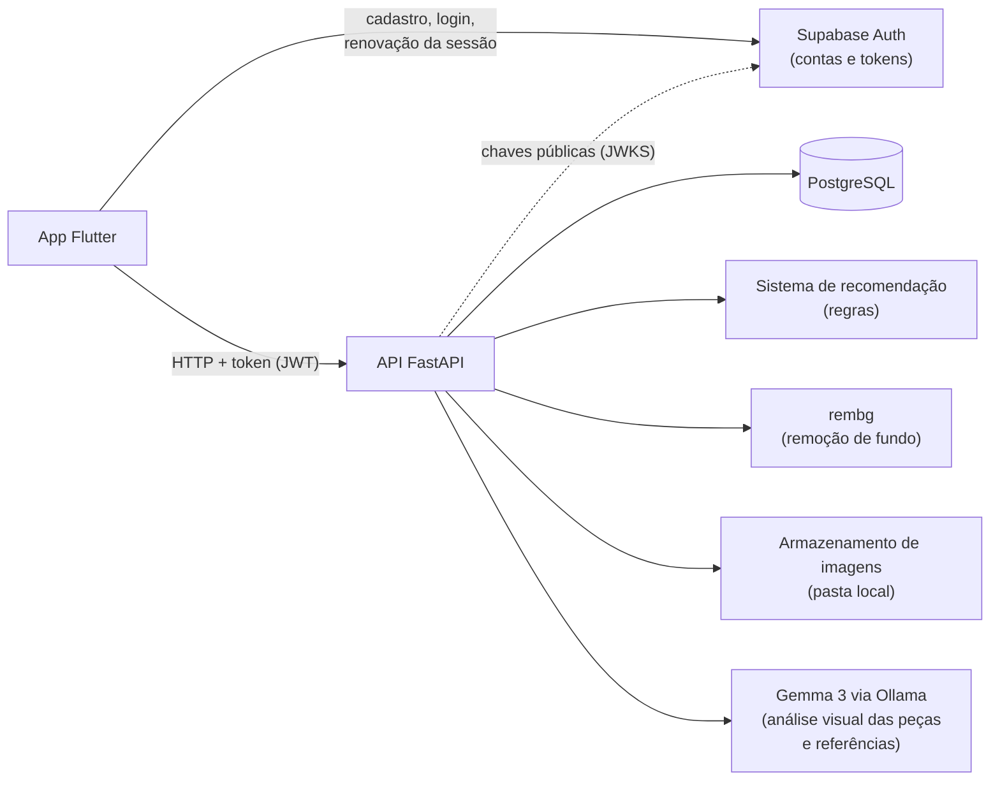

Fonte: elaborado pela autora (2026).

### 5.1 Organização do servidor e padrões de projeto

O servidor é dividido em camadas, para que partes que podem mudar (como o serviço de visão ou o armazenamento) sejam trocadas sem alterar o restante:

- **api/v1 (rotas):** recebem as requisições HTTP e validam os dados. Não chamam `rembg` ou IA diretamente.
- **services:** regras de negócio, incluindo o sistema de recomendação.
- **adapters:** comunicação com `rembg`, armazenamento e Gemma 3.
- **db (models):** tabelas do banco, em SQLAlchemy.
- **schemas:** formatos de entrada e saída dos dados, em Pydantic.
- **core:** configurações da aplicação e validação do token de autenticação emitido pelo Supabase Auth.

Essa organização segue padrões de projeto conhecidos (GAMMA et al., 1994; FOWLER, 2002):

Quadro 7 – Padrões de projeto aplicados

| Padrão | Onde aparece | Para que serve |
| --- | --- | --- |
| Arquitetura em camadas | rotas → serviços → adaptadores/banco | Cada parte tem uma responsabilidade; mudar uma não obriga a mudar as outras. |
| Camada de serviço (*Service Layer*) | `services/` | A lógica fica fora das rotas e pode ser testada sem servidor nem banco. |
| Adaptador (*Adapter*) | `adapters/` | Trocar o armazenamento local por nuvem, ou o provedor de IA, muda só o adaptador. |
| Injeção de dependência | `Depends` do FastAPI | O usuário sempre vem do token; nos testes, as dependências são substituídas. |
| Exclusão lógica | campo `arquivado` nas combinações | Excluir uma combinação não apaga o histórico de uso dela. |

Fonte: elaborado pela autora (2026).

### 5.2 Organização do aplicativo

O aplicativo é organizado em `core` (tema, constantes, comunicação com a API e autenticação), `models`, `services` (um por recurso, chamam a API) e `views` (telas e seus controladores de estado, com Riverpod). A sessão do usuário é mantida pelo pacote `supabase_flutter`, e um interceptor das requisições envia o token da sessão, renova-o quando expira e, se a renovação falhar, leva o usuário de volta ao login. As telas não falam diretamente com a API, o que permite testá-las com serviços falsos. A navegação principal tem cinco abas: Casa, Armário, Montar, Sugestões e Referências.

### 5.3 Fluxo de cadastro de uma peça (implementado)

1. O usuário tira uma foto ou escolhe uma da galeria, pode recortá-la manualmente e vê uma pré-visualização.
2. O aplicativo envia a foto para `POST /pecas/processar-imagem`.
3. A API confere o token e o arquivo (formato real JPEG, PNG ou WebP, até 10 MB), remove o fundo com `rembg`, salva a imagem em uma pasta local do servidor e devolve o localizador uniforme de recursos (URL), junto com a sugestão de atributos do Gemma 3 (seção 5.8).
4. O aplicativo mostra o resultado. Se o processamento falhar, oferece continuar com a foto original (`POST /pecas/upload-original`).
5. O usuário revisa e completa categoria, subcategoria, cor principal, cores secundárias, tonalidade, estações, ocasiões, estilos e modelagem (apenas a categoria é obrigatória).
6. O aplicativo envia os dados para `POST /pecas`, com o token da sessão, e a peça é salva no banco associada ao usuário.

### 5.4 Sistema de recomendação

As regras completas estão em `docs/regras-sugestoes.md`. Em resumo:

1. **Estrutura:** parte de cima + parte de baixo + sapato, ou vestido + sapato. Casaco só no outono/inverno ou se o usuário gosta de sobreposições.
2. **Cores:** cada par de peças recebe uma "ousadia" de 0 a 4, conforme a distância das cores no círculo cromático (neutros e mesma cor = 0; cores opostas = 4). A combinação só entra se a ousadia couber no nível de criatividade escolhido pelo usuário.
3. **Restrições:** filtros de ocasião, estilo, estação e cor; peças e combinações evitadas nunca entram.
4. **Ordenação:** combinações de cor favoritas, cadastro completo, estilos preferidos e **peças menos usadas** vêm primeiro.
5. **Combinação do dia:** usa o mesmo sistema, priorizando peças esquecidas (sem uso há mais de 30 dias).

Cada recomendação mostra o motivo e avisos como "falta calçado" ou "cadastro incompleto". O nível de criatividade e as preferências são definidos pelo próprio usuário, de modo que o sistema estimula a experimentação sem impor um padrão estético único (ver também a seção 2.4).

**Peças paradas.** Separado do sistema de recomendação, um aviso exibido ao abrir o aplicativo, no máximo uma vez por sessão, mostra a peça há mais tempo sem uso entre as que estão há 90 dias ou mais sem aparecer em uma combinação usada; peça nunca usada conta a partir da data de cadastro. O usuário pode pedir recomendações com a peça fixa, adiar o lembrete por 30 dias ou escolher "Doar", que apenas exclui a peça do aplicativo, sem integração com serviços de doação. Os prazos são fixos nesta versão e não consideram peças sazonais.

### 5.5 Modelo de dados

Quadro 8 – Principais tabelas do banco de dados

| Tabela | Principais campos |
| --- | --- |
| `pecas` | id, usuario_id, imagem_url, categoria, subcategoria, cor_principal, cores_secundarias, tonalidade_cor, estacoes, ocasioes, estilos, modelagem, lembrete_adiado_ate, criado_em |
| `looks` | id, usuario_id, nome, favorito, ocasioes, arquivado, pasta_id, criado_em |
| `pastas_looks` | id, usuario_id, nome, criado_em |
| `looks_pecas` | associação N:N entre combinações e peças |
| `looks_usos` | id, look_id, usuario_id, usado_em |
| `preferencias` | usuario_id, estilos, sobreposicoes, combinacoes_cores, criatividade, ocasiao_look_do_dia |
| `pecas_evitadas` / `combinacoes_evitadas` | peças e pares que o usuário não quer nas recomendações |
| `referencias` | id, usuario_id, imagem_url, nota, colecao_id, look_id, etiquetas, criado_em |
| `colecoes` | id, usuario_id, nome, criado_em |

Fonte: elaborado pela autora (2026).

As tabelas foram criadas por 19 migrações do Alembic (`0001_initial` a `0019_pastas_de_looks`). Os nomes técnicos das tabelas (como `looks`) foram mantidos conforme o código. As contas de usuário ficam no Supabase Auth; o banco guarda apenas o identificador de cada usuário (`usuario_id`), sem chave estrangeira para o Supabase.

### 5.6 Rotas da API

Todas as rotas ficam sob `/api/v1` e exigem o token emitido pelo Supabase Auth, inclusive `POST /pecas/processar-imagem` e `POST /pecas/upload-original`, e filtram os dados pelo usuário dele. Tentar usar uma peça de outro usuário resulta em erro, sem revelar que a peça existe. A listagem de peças (`GET /pecas`) é paginada, aceita filtros e informa o total no cabeçalho `X-Total-Count`.

Quadro 9 – Rotas da API

| Recurso | Rotas |
| --- | --- |
| Peças | `POST /pecas/processar-imagem`, `POST /pecas/upload-original`, `POST /pecas`, `GET /pecas`, `GET /pecas/paradas`, `POST /pecas/{id}/adiar-lembrete`, `PUT /pecas/{id}`, `DELETE /pecas/{id}` |
| Combinações | `POST /looks`, `GET /looks`, `PATCH /looks/{id}`, `DELETE /looks/{id}`, `POST /looks/{id}/usos`, `GET /looks/historico`, `DELETE /looks/usos/{id}` |
| Pastas de combinações | `POST /pastas`, `GET /pastas`, `PATCH /pastas/{id}`, `DELETE /pastas/{id}` |
| Preferências | `GET /preferencias`, `PATCH /preferencias`, `GET /preferencias/evitadas` e rotas de criação e remoção de peças e combinações evitadas |
| Recomendações | `POST /sugestoes`, `POST /sugestoes/look-do-dia` |
| Referências | `POST /referencias`, `GET /referencias`, `PATCH /referencias/{id}`, `DELETE /referencias/{id}`, `POST /referencias/{id}/sugestao-de-look` |
| Coleções | `POST /colecoes`, `GET /colecoes`, `PATCH /colecoes/{id}`, `DELETE /colecoes/{id}` |

Fonte: elaborado pela autora (2026).

### 5.7 Modelagens

Os diagramas a seguir representam o sistema do ponto de vista funcional, estático e dinâmico.

**Modelagem funcional — casos de uso.** O ator principal é o usuário; o `rembg` e o Gemma 3 atuam como sistemas externos.

Figura 2 – Diagrama de casos de uso

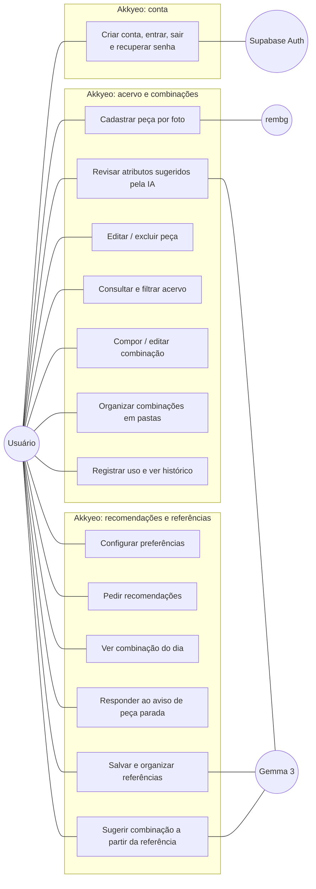

Fonte: elaborado pela autora (2026).

**Modelagem estática — modelo de dados.**

Figura 3 – Modelo de dados (entidade-relacionamento)

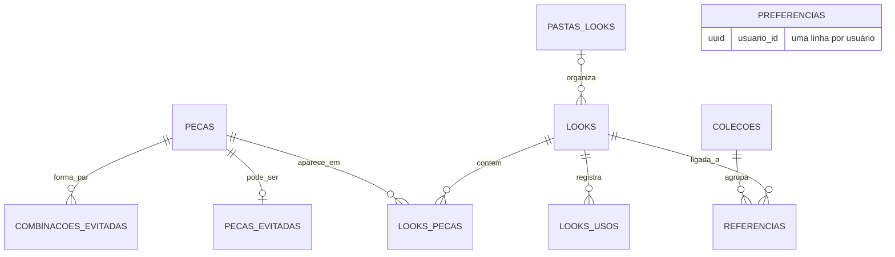

Fonte: elaborado pela autora (2026).

Todas as tabelas têm `usuario_id`, exceto a associação `looks_pecas`, que liga uma combinação às suas peças; a tabela `preferencias` tem uma linha por usuário. As contas ficam no Supabase Auth, sem chave estrangeira para ele. Os campos de cada tabela estão na seção 5.5.

**Modelagem dinâmica — cadastro de peça (implementado).**

Figura 4 – Diagrama de sequência do cadastro de peça

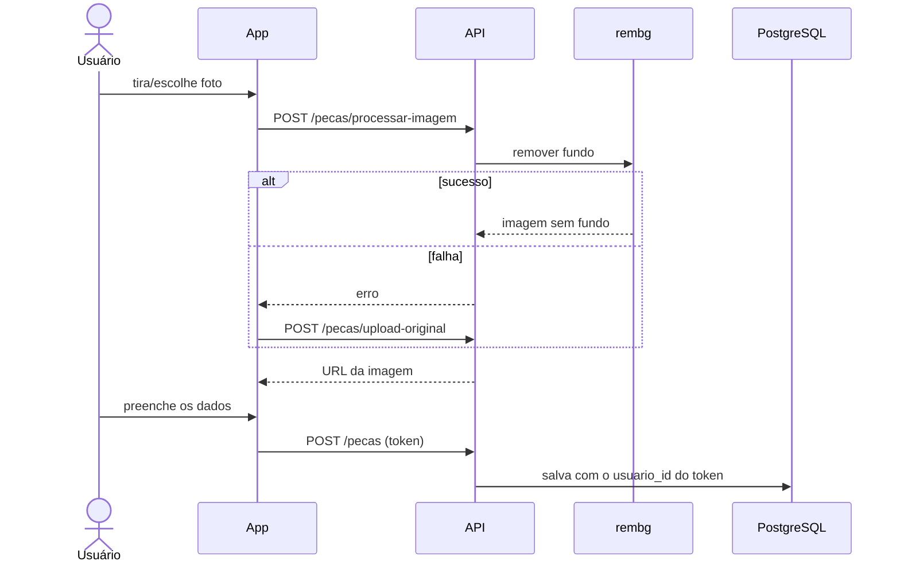

Fonte: elaborado pela autora (2026).

**Modelagem dinâmica — pedido de recomendações (implementado).**

Figura 5 – Diagrama de sequência do pedido de recomendações

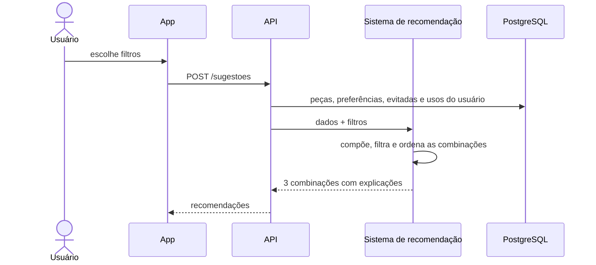

Fonte: elaborado pela autora (2026).

### 5.8 Cadastro assistido pelo Gemma 3

O cadastro assistido é a primeira aplicação de inteligência artificial do Akkyeo. O fluxo é:

1. O usuário seleciona ou envia uma fotografia de uma peça de roupa.
2. O Gemma 3 analisa visualmente a imagem.
3. O modelo sugere informações como categoria da peça, cores e outras características visuais que possam ser identificadas com razoável confiabilidade.
4. O aplicativo apresenta os dados sugeridos para o usuário revisar e corrigir.
5. Após a confirmação, as informações são salvas no cadastro da peça.

Figura 6 – Diagrama de sequência do cadastro assistido pelo Gemma 3

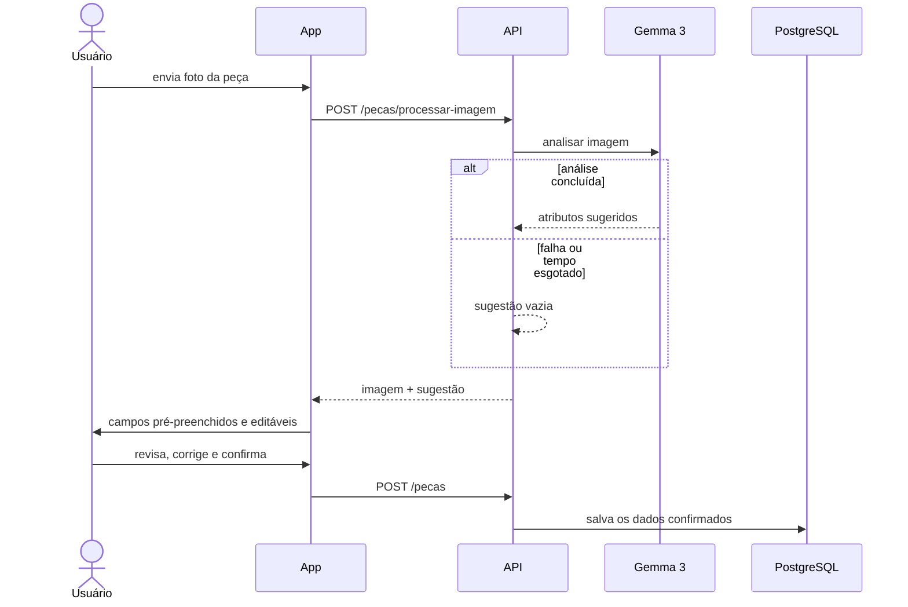

Fonte: elaborado pela autora (2026).

**Implementação.** O serviço de processamento de imagem chama o adaptador do Ollama, que envia a foto já sem fundo ao Gemma 3 (`gemma3:4b`) e pede uma resposta estruturada com categoria, subcategoria, cor principal e tonalidade. Valores fora das listas do aplicativo são descartados. O formulário de cadastro abre com os campos preenchidos e o aviso "Sugerido pela IA - revise antes de salvar". Em testes com o modelo real, a análise levou de 7 a 13 s por foto.

**Princípios.** As respostas do modelo não são tratadas como infalíveis: toda característica identificada pode ser revisada e corrigida, e nada é salvo sem confirmação do usuário. A chamada ao modelo tem tempo limite configurável (30 s por padrão); em caso de falha, demora ou resposta inválida, a sugestão volta vazia e o cadastro segue com preenchimento manual.

### 5.9 Mural de referências visuais (Épico 8)

Inspirado no conceito de murais de referências, semelhante à organização visual encontrada no Pinterest, o mural permite ao usuário reunir imagens de roupas, estilos e combinações que considere interessantes e utilizá-las como ponto de partida para explorar possibilidades com as peças que já possui. Não há integração direta com a API do Pinterest: as imagens são importadas da galeria do próprio dispositivo.

O mural foi implementado em cinco funcionalidades:

1. **Mural básico:** grade de imagens, com nota opcional e exclusão.
2. **Coleções:** agrupamento das referências, com criação, renomeação e exclusão.
3. **Ligação a uma combinação:** a referência pode ser ligada a uma combinação já salva, que passa a ser exibida junto com a imagem.
4. **Etiquetas por IA:** ao enviar a referência, o Gemma 3 lista as peças visíveis (por exemplo, "camisa branca", "calça jeans") como etiquetas editáveis (5 a 12 s por imagem).
5. **Ligação automática:** a partir das etiquetas, regras selecionam até quatro peças candidatas do acervo por etiqueta, sem as peças evitadas; o Gemma 3 compara a referência com essas candidatas e propõe uma combinação, indicando lacunas quando não há peça equivalente. A proposta só é ligada ou salva depois da confirmação do usuário.

Nos testes com o modelo real, a ligação automática levou cerca de 35 s para cinco etiquetas, com precisão considerada média; a melhoria dessa precisão é tratada como evolução (seção 9).

### 5.10 Acessibilidade e apoio a diferentes necessidades

O Akkyeo se propõe a apoiar quem precisa ou deseja auxílio na escolha do que vestir: o aplicativo organiza o que a pessoa tem, sugere combinações adequadas à ocasião e explica o porquê de cada sugestão, sem pretender substituir a orientação de um consultor de imagem ou assessor de moda. Esse público é amplo e inclui, por exemplo, pessoas com dificuldade de distinguir cores, com pouco tempo, com pouca familiaridade com combinações ou inseguras com o próprio estilo, além de quem usa recursos como leitores de tela. Como o aplicativo trabalha intensamente com cores, a acessibilidade é tratada como preocupação de projeto. O princípio adotado é **não depender exclusivamente de estímulos visuais para transmitir informações importantes**, alinhado às diretrizes de acessibilidade para conteúdo web (W3C, 2023).

Os recursos considerados são simples e viáveis:

- exibir o nome da cor em texto junto à sua representação visual;
- não utilizar apenas cores para indicar seleção, erros, filtros ativos ou outras informações importantes, combinando-as com ícones, texto ou formas;
- manter contraste adequado e textos legíveis;
- utilizar rótulos compreensíveis, considerar o uso de leitores de tela e garantir áreas de toque adequadas.

Esses princípios foram aplicados em uma revisão de usabilidade e acessibilidade da interface: os seletores de cor apresentam as cores pelo nome; os cartões de peças e o botão de filtros têm descrições para leitores de tela (por exemplo, "Filtros, 2 marcados"); o botão de filtros combina ícone e texto; áreas de toque menores foram ampliadas para pelo menos 48 px; e as telas foram testadas com fonte do sistema ampliada em duas vezes. A revisão sistemática dos pontos em que a cor ainda é o único indicador e a verificação do contraste segundo as Diretrizes de Acessibilidade para Conteúdo Web (WCAG) estão previstas para a próxima etapa (seção 8). Cada recomendação mostra o motivo de ter sido sugerida (seção 5.4), o que ajuda quem busca orientação. Não faz parte do escopo identificar o tipo de daltonismo do usuário nem realizar análise especializada de cores.

---

## 6 Desenvolvimento e resultados

### 6.1 Funcionalidades entregues

As funcionalidades a seguir estão implementadas e cobertas por testes automatizados; a verificação realizada está descrita na seção 6.3.

**Cadastro de peças.** O usuário captura ou escolhe uma foto, pode recortá-la, vê a prévia, envia para processamento e confirma o resultado. Em seguida, revisa os atributos sugeridos pelo Gemma 3 e completa o cadastro. Quando ocorre erro, o aplicativo mostra uma mensagem clara e permite continuar com a foto original (Figura 7).

Figura 7 – Cadastro de peça: (a) imagem com o fundo removido; (b) atributos sugeridos pelo Gemma 3 para revisão do usuário

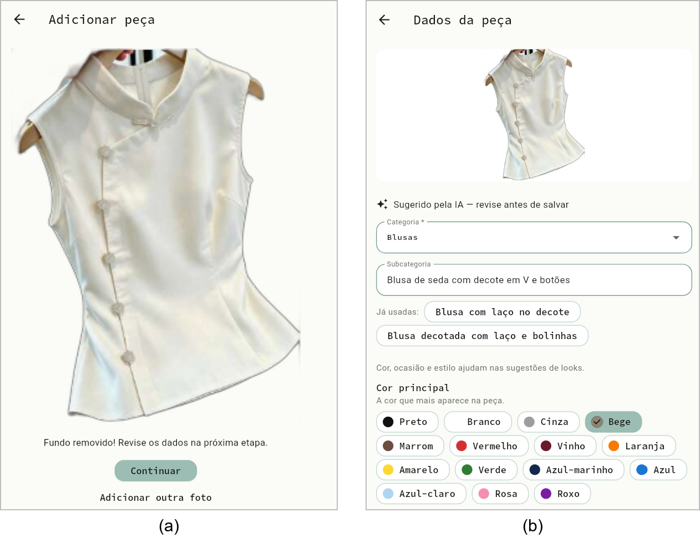

Fonte: elaborado pela autora (2026).

**Acervo.** As peças aparecem em carrosséis por categoria (gavetas), carregados aos poucos, e cada gaveta pode ser aberta em uma visão com rolagem contínua; há filtros por cor, estação e ocasião. Peças com cadastro incompleto recebem um selo. Ao tocar numa peça, abre-se o detalhe, de onde é possível editar, excluir ou pedir recomendações a partir dela (Figura 8).

Figura 8 – (a) Demais atributos da peça; (b) acervo organizado por categoria

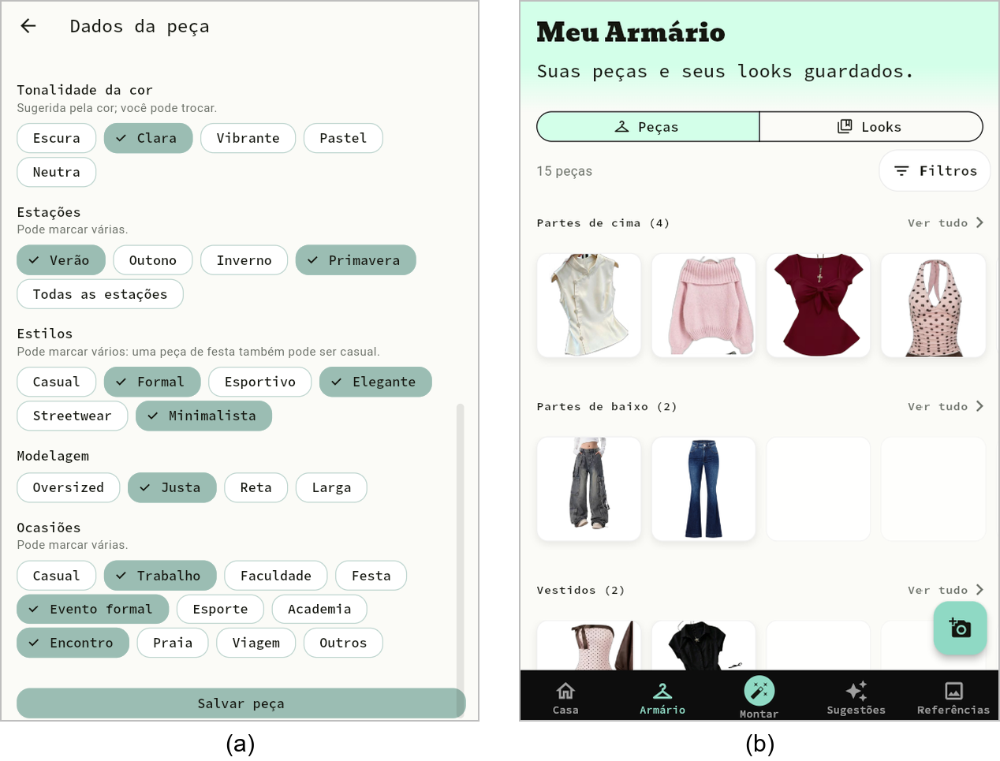

Fonte: elaborado pela autora (2026).

**Combinações.** O usuário compõe combinações com peças do próprio acervo, dá nome, escolhe ocasiões, favorita, organiza em pastas, edita e exclui. Pode marcar "usei hoje" (ou outra data), ver o histórico em um calendário e recebe um aviso quando uma combinação foi usada há poucos dias (Figura 9, item a).

**Preferências de estilo.** Combinações de cores que o usuário aprecia, estilos preferidos, sobreposições, peças e combinações a evitar e nível de criatividade das combinações (Figura 9).

Figura 9 – (a) Composição de uma combinação; (b) preferências de estilo

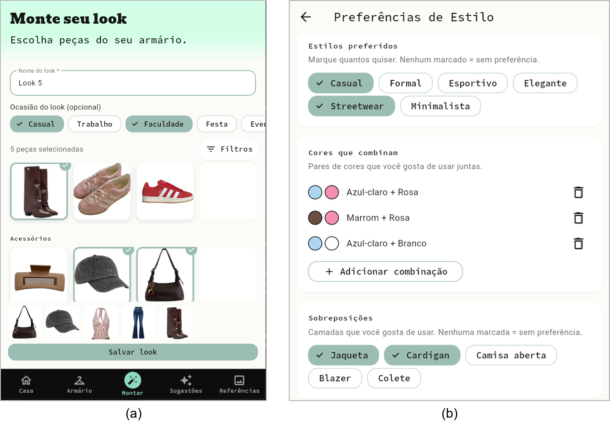

Fonte: elaborado pela autora (2026).

**Recomendações.** Uma aba mostra três combinações recomendadas por vez, com filtros, opção de ver outras, descartar e salvar. Na tela inicial, um card de "combinação do dia" sugere uma composição que privilegia peças esquecidas (Figuras 10 e 11).

Figura 10 – Recomendações: (a) filtros e nível de criatividade; (b) combinações sugeridas, com a explicação de cada uma

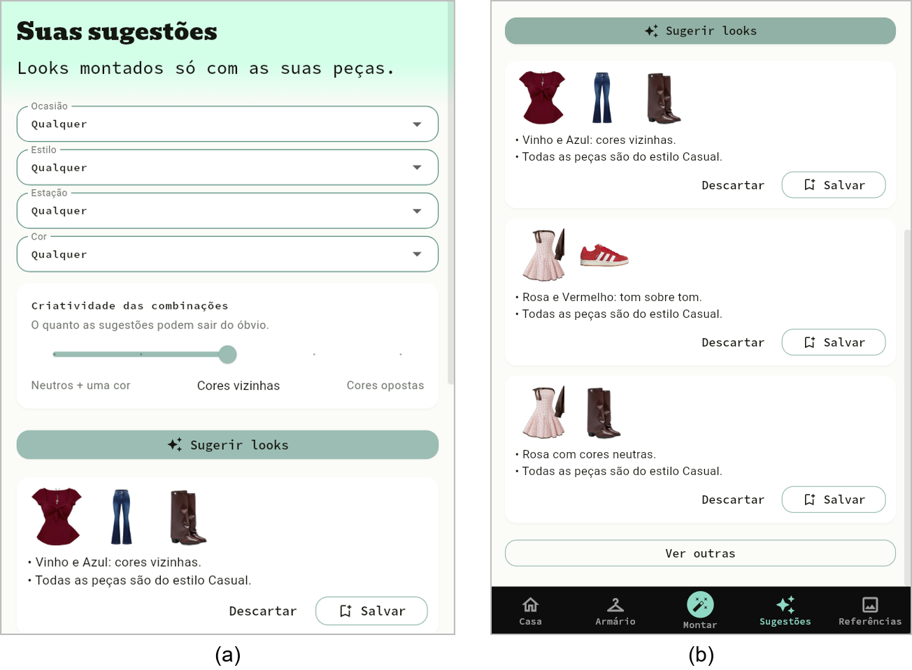

Fonte: elaborado pela autora (2026).

Figura 11 – Tela inicial com a combinação do dia e o calendário de combinações usadas

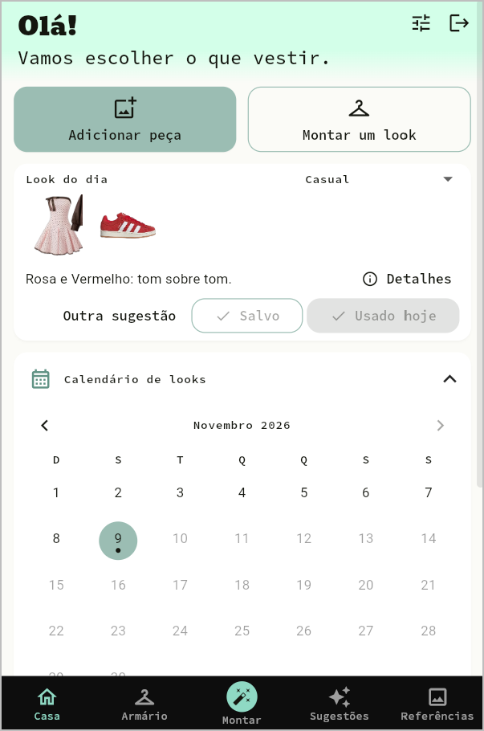

Fonte: elaborado pela autora (2026).

**Mural de referências.** O usuário reúne imagens de inspiração, organiza-as em coleções, recebe etiquetas das peças visíveis sugeridas pela IA e liga cada referência a uma combinação, escolhida manualmente ou proposta automaticamente a partir do próprio acervo (Figura 12).

Figura 12 – Mural de referências: (a) imagens salvas; (b) combinação montada com peças do acervo a partir de uma referência, com as peças sem equivalente indicadas

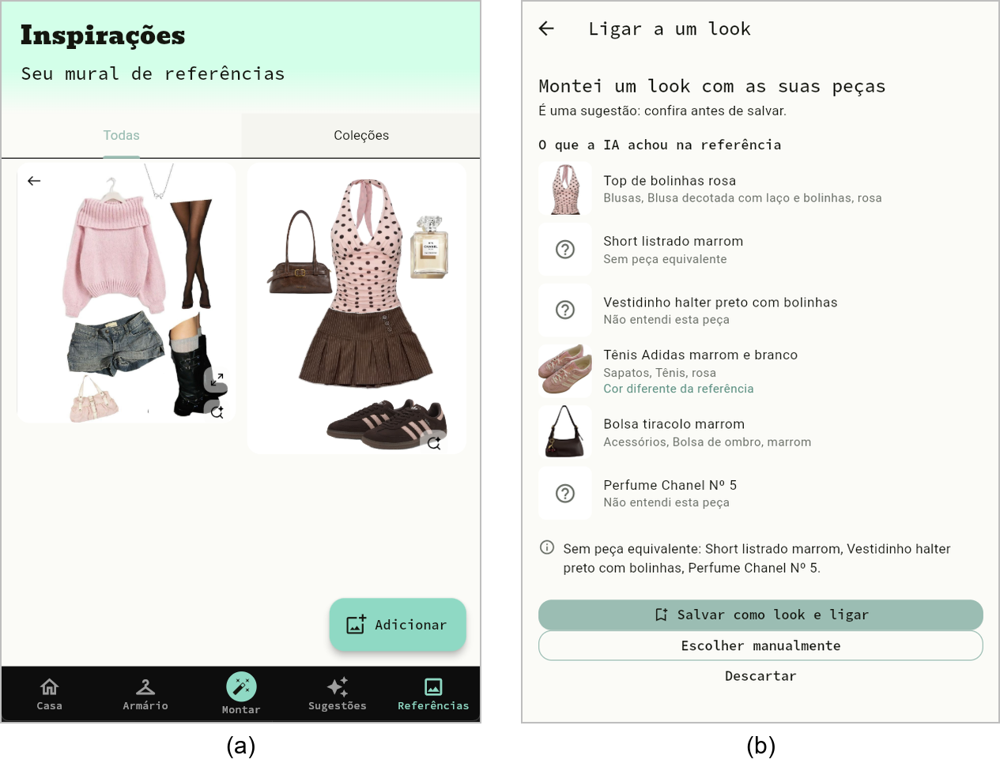

Fonte: elaborado pela autora (2026).

**Peças paradas.** Ao abrir o aplicativo, um aviso apresenta a peça há mais tempo sem uso (90 dias ou mais), com as opções de sugerir uma combinação com ela, lembrar depois (30 dias) ou doar, que a exclui do aplicativo (seção 5.4).

**Conta e sessão.** Cadastro, login e logout com e-mail e senha, recuperação de senha por link enviado por e-mail e aviso de sessão expirada, com retorno ao login. Ao trocar de usuário, todo o estado em memória do aplicativo é descartado. A recuperação de senha funciona apenas quando o link é aberto no mesmo navegador. Essas funcionalidades foram validadas no Chrome em 8 de novembro de 2026, com duas contas, cada uma vendo apenas os próprios dados.

**Acessibilidade.** Rótulos para leitores de tela, áreas de toque ampliadas, botão de filtros com ícone e texto e telas que suportam fonte ampliada.

**Identidade visual.** O aplicativo foi redesenhado a partir de um protótipo no Figma, com navegação inferior em abas.

### 6.2 Organização do backlog

Foram detalhadas **87 PBIs**. Os 76 itens do escopo da versão inicial foram concluídos (75) ou dispensados por não se aplicarem (1, a E9.F1.3, migração de dados desnecessária porque os dados de desenvolvimento eram descartáveis); os 11 demais correspondem a evoluções futuras: o armazenamento das imagens em nuvem (Épico 10) e a pesquisa sobre o Pinterest (Épico 12). Um item é considerado concluído quando o código existe e atende aos critérios de aceite registrados, comprovados por testes automatizados e pelas verificações registradas em cada PBI. A lista completa está em `docs/backlog.md`.

Quadro 10 – Itens de backlog por épico

| Épico | PBIs | Situação |
| --- | --- | --- |
| 1 — Cadastro de roupas | 10 | 10 concluídas (2 documentadas depois da implementação; a E1.F1.7, de segurança das rotas de imagem, em 08/11/2026) |
| 2 — Organização | 2 | Concluídas |
| 3 — Looks manuais | 17 | Concluídas (inclui as pastas de combinações) |
| 4 — Preferências de estilo | 8 | Concluídas |
| 5 — Sugestões sob demanda | 7 | Concluídas |
| 6 — Look do dia | 3 | Concluídas |
| 7 — Cadastro assistido por IA | 2 | Concluídas |
| 8 — Mural de referências | 10 | Concluídas |
| 9 — Autenticação real | 8 | 7 concluídas, 1 dispensada |
| 10 — Imagens em nuvem | 9 | Evolução futura |
| 11 — Paginação do acervo | 6 | Concluídas |
| 12 — Pesquisa sobre o Pinterest | 2 | Evolução futura |
| 13 — Peças paradas | 3 | Concluídas |
| **Total** | **87** | 76 da versão inicial (75 concluídas, 1 dispensada); 11 de evolução futura |

Fonte: elaborado pela autora (2026).

### 6.3 Verificação realizada

- **Servidor:** 437 testes automatizados (`pytest`), cobrindo as regras do sistema de recomendação, o adaptador do Ollama, o módulo de inspiração, a validação do token de autenticação, a configuração de produção, as rotas de processamento de imagem e, contra o PostgreSQL local, as rotas de peças, referências, coleções e pastas e o isolamento entre usuários. Na execução completa de 08/11/2026, com o PostgreSQL local ligado, os 437 testes passaram.
- **Aplicativo:** 428 testes automatizados (`flutter test`), todos passando (execução de 08/11/2026).
- **Execução real:** 11 PBIs de servidor foram testadas com a API rodando contra um PostgreSQL local, com dois usuários de teste, confirmando que um não acessa os dados do outro (contagem até 01/11/2026); as PBIs de servidor posteriores também foram conferidas com chamadas diretas à API real.
- **Isolamento e autenticação:** 51 testes automatizados de isolamento cobrem 35 das 37 rotas da API (as duas restantes não leem nem gravam dados de usuário) e não encontraram vazamento de dados entre usuários. O login real foi validado no Chrome com duas contas.
- **Rotas de processamento de imagem:** 18 testes automatizados (autenticação, tipo real do arquivo, limite de 10 MB, extensão gravada e falhas do processamento), com a remoção de fundo e o Gemma 3 simulados; o processamento com o `rembg` real foi verificado manualmente durante o desenvolvimento e não é repetido nos testes automatizados.
- **Desempenho:** recomendações para um acervo de 100 peças geradas em 0,62 s.
- **Inteligência artificial com o modelo real:** sugestão de atributos no cadastro em 7 a 13 s por foto; etiquetas das referências em 5 a 12 s; ligação automática em cerca de 35 s para cinco etiquetas, com precisão média.
- **Teste preliminar do modelo de visão:** fora do aplicativo, o Gemma 3 4B, rodando pelo Ollama no notebook de desenvolvimento, classificou corretamente a foto de uma camiseta roxa (categoria, cor e tonalidade, dentro das listas do aplicativo), em cerca de 3 s com o modelo já carregado e 17,5 s na primeira chamada, dividindo o processamento entre a unidade central de processamento (CPU) e a unidade de processamento gráfico (GPU). Também mostrou um limite a tratar na implementação: no campo de subcategoria, repetiu o texto da instrução em vez de descrever a peça.
- Nesse processo foram encontrados e corrigidos erros reais, como uma falha de serialização na criação de combinações e um valor nulo que gerava erro de banco em vez de uma mensagem de validação.

---

## 7 Limitações

1. **Rotas de imagem protegidas.** O login real com Supabase Auth foi integrado e, desde 08/11/2026, `POST /pecas/processar-imagem` e `POST /pecas/upload-original` exigem autenticação, limitam o tamanho do arquivo a 10 MB, verificam o tipo real do arquivo (JPEG, PNG ou WebP) e `upload-original` grava com a extensão do formato detectado, não com a enviada pelo cliente (PBI E1.F1.7, com testes automatizados). Os arquivos salvos ficam numa pasta do servidor (item 7); o armazenamento privado no Supabase Storage, com isolamento dos arquivos (E10.F2.2), faz parte do Épico 10, previsto para versão futura.
2. **Verificação apoiada em testes automatizados.** O aplicativo foi utilizado pela autora, e a verificação apoia-se nos testes automatizados e nas verificações registradas em cada PBI; o uso por outras pessoas é proposto como estudo futuro (seção 9).
3. **Execução no navegador.** Embora o Flutter permita gerar versões para Android e iOS, o aplicativo foi executado e validado no Chrome, e a execução em Android e iOS está prevista na próxima etapa (seção 8); a recuperação de senha, em particular, depende de abrir o link no mesmo navegador.
4. **Avaliação com usuários como trabalho futuro.** A hipótese da seção 1.3 será verificada em um estudo com usuários, proposto na seção 9.
5. **Precisão e tempo da IA.** O modelo pequeno executado localmente pode errar atributos, e a ligação automática do mural tem precisão média e leva cerca de 35 s.
6. **Revisão sistemática de acessibilidade.** A revisão dos pontos em que a cor é o único indicador e a verificação do contraste estão previstas na próxima etapa (seção 8).
7. **Armazenamento local e público.** As imagens ficam numa pasta do servidor, acessível sem autenticação a quem tiver o endereço de cada imagem, e excluir uma peça não apaga o arquivo da imagem. A migração para um serviço de nuvem com acesso restrito (Épico 10) está planejada para versão futura e fora da versão inicial; essa característica deve ser considerada antes de disponibilizar o aplicativo a outras pessoas.
8. **Estação definida pelo usuário.** A estação é escolhida pelo usuário; a consulta à previsão do tempo é uma evolução futura (seção 9).
9. **Exclusão de conta.** Excluir um usuário no Supabase não remove suas peças, combinações, preferências, referências e imagens, pois o banco PostgreSQL é separado do Supabase. A remoção integrada desses dados deve acompanhar a disponibilização do aplicativo a terceiros em escala.
10. **Prazos fixos no aviso de peças paradas.** Os limites de 90 e 30 dias são fixos e não consideram roupas sazonais, que podem ficar meses sem uso por motivo legítimo.
11. **Paginação por deslocamento.** Uma peça criada ou excluída enquanto o acervo é carregado pode fazer um item se repetir ou ser pulado entre duas páginas; o aplicativo descarta repetições e atualiza a lista quando o usuário a puxa para baixo.
12. **Infraestrutura de IA local.** O Gemma 3 roda pelo Ollama no notebook de desenvolvimento, e a remoção de fundo e a análise da imagem acontecem dentro da própria requisição, sem fila. Para usuários externos será necessário um servidor com capacidade para o modelo; sem ele, o cadastro continua funcionando, mas sem as sugestões da IA.
13. **Execução em ambiente de desenvolvimento.** A API, o banco e o modelo de IA rodam na máquina de desenvolvimento; a publicação da API, a execução das migrações como etapa de implantação, o HTTPS e o limite de requisições fazem parte da preparação do ambiente de produção (seção 8).
14. **Testes com a remoção de fundo real.** A suíte completa do servidor, com os testes que dependem do PostgreSQL local, foi executada em 08/11/2026 e passou (437 testes); o teste com o `rembg` real nas rotas de imagem e a medição do tamanho de um recorte PNG real frente ao limite de 10 MB estão previstos na próxima etapa (seção 8).

---

## 8 Próximos passos

1. Medir o tamanho de um recorte PNG real frente ao limite de 10 MB e executar o teste de fumaça com a remoção de fundo real.
2. Realizar a revisão sistemática de acessibilidade das cores e do contraste (seção 5.10).
3. Mover as imagens para o Supabase Storage, com armazenamento privado e isolamento por usuário (Épico 10, planejado para versão futura e fora da versão inicial).
4. Publicar o aplicativo em um ambiente acessível a outras pessoas e testá-lo em dispositivos Android ou iOS.
5. Definir o ambiente de produção da API, do banco e do modelo de IA.
6. Realizar a avaliação com usuários (seção 9) e analisar os resultados.

### 8.1 Cronograma

Quadro 11 – Cronograma

| Período | Atividade | Situação |
| --- | --- | --- |
| Ago/2026 | Visão, requisitos, arquitetura e estrutura do projeto | Concluído |
| Set/2026 | Cadastro de peças e organização do acervo (Épicos 1 e 2) | Concluído |
| Set–Out/2026 | Looks e preferências de estilo (Épicos 3 e 4) | Concluído |
| Out/2026 | Sistema de recomendação e look do dia (Épicos 5 e 6) | Concluído |
| Out/2026 | Cadastro assistido pelo Gemma 3 e mural de referências (Épicos 7 e 8) | Concluído |
| Nov/2026 | Pastas de combinações, paginação do acervo, peças paradas e autenticação real (Épicos 3, 11, 13 e 9) | Concluído |
| 09/Nov/2026 | Relatório técnico no modelo institucional da Associação Brasileira de Normas Técnicas (ABNT) e apresentação | Planejado |
| 09/Nov/2026 | Envio do relatório à banca | Planejado |
| 13/Nov/2026 | Defesa | Planejado |

Fonte: elaborado pela autora (2026).

---

## 9 Evoluções futuras

As funcionalidades e os estudos desta seção **não fazem parte do escopo da versão inicial** e não são requisitos obrigatórios do trabalho de conclusão de curso (TCC). Elas indicam caminhos de evolução do Akkyeo após a consolidação das funcionalidades planejadas.

**Avaliação com usuários.** Um estudo com usuários, que meça o tempo para compor uma combinação, a variedade de peças efetivamente usadas, a partir dos registros de uso do próprio aplicativo, e a usabilidade, permitirá verificar a hipótese da seção 1.3 e os benefícios esperados (seção 1.7).

**Assistente conversacional.** Um assistente com o qual o usuário possa interagir em linguagem natural para explicar suas preferências, seu estilo pessoal, suas dificuldades e o que procura para determinada ocasião. A intenção é permitir que o usuário descreva sua personalidade e seu gosto de maneira mais natural do que por formulários, oferecendo uma experiência mais personalizada. Futuramente, esse assistente poderia ajudar a explorar novas possibilidades e a interpretar pedidos mais complexos, possivelmente traduzindo-os em filtros e preferências para o sistema de recomendação.

**Busca por similaridade visual.** A ligação automática entre referências e acervo hoje depende das etiquetas e da comparação feita pelo Gemma 3, com precisão média. Uma evolução é representar peças e referências por vetores (*embeddings*) e buscar as mais parecidas com a extensão `pgvector` (PGVECTOR, [2026?]), o que tende a melhorar a precisão e reduzir o tempo de resposta.

**Outras possibilidades.** Integração com o Pinterest, condicionada a uma pesquisa de viabilidade (Épico 12); consulta ao clima em tempo real; personalização avançada com base no histórico de uso; e um avatar em estilo *pixel art* que vista as combinações do usuário, sempre com peças do próprio acervo (Épico 14).

---

## 10 Considerações finais

O Akkyeo oferece um ciclo completo de gestão do vestuário pessoal: cadastrar peças por fotografia com apoio de inteligência artificial, organizar o acervo, compor e registrar combinações, declarar preferências, receber recomendações que usam apenas peças do próprio usuário e priorizam as esquecidas, e ser lembrado das peças sem uso há muito tempo. O mural de referências estendeu esse ciclo à inspiração visual, sempre traduzida para o acervo real, e a autenticação com o Supabase Auth permitiu que cada pessoa tenha a própria conta, com isolamento dos dados verificado por testes. Com isso, o produto oferece meios para enfrentar a subutilização do vestuário e as dificuldades cotidianas descritas na introdução, cuja efetividade poderá ser verificada em um estudo com usuários.

Do ponto de vista técnico, a separação entre o reconhecimento de imagens, probabilístico e sempre revisado pelo usuário, e o sistema de recomendação, determinístico e testável, mostrou-se adequada: permitiu trocar o provedor de IA sem afetar o restante do sistema e manter as recomendações explicáveis. A execução local do modelo eliminou custos por uso e o envio de fotos a terceiros, ao preço de respostas mais lentas e de precisão limitada nas tarefas mais complexas.

A hipótese de que o aplicativo reduz o tempo de decisão e amplia o uso das peças existentes poderá ser verificada em um estudo com usuários, que permitirá confirmá-la ou refutá-la. Como trabalhos futuros, destacam-se esse estudo, o armazenamento das imagens em nuvem e a publicação do aplicativo, a validação em dispositivos móveis, a revisão sistemática de acessibilidade, a busca por similaridade visual e um assistente conversacional.

A mensagem que orienta o projeto é que renovar a forma de se vestir não exige, necessariamente, renovar constantemente o que se possui: a tecnologia pode ajudar as pessoas a descobrir e aproveitar melhor as possibilidades do próprio vestuário.

---

## Referências

ACLOSET. **Acloset - AI Fashion Assistant**. App Store. Disponível em: \<https://apps.apple.com/us/app/acloset-ai-fashion-assistant/id1542311809\>. Acesso em: 23 out. 2026.

ALEMBIC. **Alembic documentation**. [2026?]. Disponível em: \<https://alembic.sqlalchemy.org\>. Acesso em: 23 out. 2026.

APONTE, N. O. et al. Fast fashion consumption and its environmental impact: a literature review. **Sustainability: Science, Practice and Policy**, v. 20, n. 1, art. 2381871, 2024. DOI: 10.1080/15487733.2024.2381871. Disponível em: \<https://doi.org/10.1080/15487733.2024.2381871\>. Acesso em: 7 nov. 2026.

BURKE, R. Hybrid recommender systems: survey and experiments. **User Modeling and User-Adapted Interaction**, v. 12, n. 4, p. 331–370, 2002.

COMBYNE. **About combyne**. Disponível em: \<https://www.combyne.com/about\>. Acesso em: 23 out. 2026.

CORRÊA, S. B.; DUBEUX, V. J. C. Comprando "roupa de brechó": uma análise sobre o consumo de vestuário de segunda mão entre jovens na cidade do Rio de Janeiro. **Comunicação Mídia e Consumo**, v. 12, n. 33, p. 34–56, 2015. DOI: 10.18568/cmc.v12i33.804. Disponível em: \<https://revistacmc.espm.br/revistacmc/article/view/804\>. Acesso em: 7 nov. 2026.

ELLEN MACARTHUR FOUNDATION. **A new textiles economy: redesigning fashion's future**. 2017. Disponível em: \<https://www.ellenmacarthurfoundation.org/a-new-textiles-economy\>. Acesso em: 23 out. 2026.

ELLIOT, A. J.; MAIER, M. A. Color psychology: effects of perceiving color on psychological functioning in humans. **Annual Review of Psychology**, v. 65, n. 1, p. 95–120, 2014. DOI: 10.1146/annurev-psych-010213-115035. Disponível em: \<https://doi.org/10.1146/annurev-psych-010213-115035\>. Acesso em: 8 nov. 2026.

FASTAPI. **FastAPI documentation**. [2026?]. Disponível em: \<https://fastapi.tiangolo.com\>. Acesso em: 23 out. 2026.

FITS. **What does Fits do?** Disponível em: \<https://www.fits-app.com/knowledge/what-does-fits-do\>. Acesso em: 23 out. 2026.

FLUTTER. **Flutter documentation**. [2026?]. Disponível em: \<https://docs.flutter.dev\>. Acesso em: 23 out. 2026.

FOWLER, M. **Patterns of enterprise application architecture**. Boston: Addison-Wesley, 2002.

GAMMA, E. et al. **Design patterns: elements of reusable object-oriented software**. Reading: Addison-Wesley, 1994.

GEMMA TEAM. Gemma 3 technical report. **arXiv preprint**, arXiv:2503.19786, 2025. Disponível em: \<https://arxiv.org/abs/2503.19786\>. Acesso em: 23 out. 2026.

GETWARDROBE. **App features**. Disponível em: \<https://help.getwardrobe.com/latest/features/\>. Acesso em: 23 out. 2026.

GOOGLE. **Criar seu closet digital com o Guarda-roupa do Google Fotos**. Ajuda do Google Fotos. [2026?]. Disponível em: \<https://support.google.com/photos/answer/17125315?hl=pt-BR\>. Acesso em: 6 nov. 2026.

GRAY, K. et al. The science of style: in fashion, colors should match only moderately. **PLOS ONE**, v. 9, n. 7, e102772, 2014. DOI: 10.1371/journal.pone.0102772. Disponível em: \<https://journals.plos.org/plosone/article?id=10.1371/journal.pone.0102772\>. Acesso em: 7 nov. 2026.

ITTEN, J. **The elements of color**. New York: Van Nostrand Reinhold, 1970.

MATHEW, M.; SPINELLI, R. Decoding sustainable drivers: a systematic literature review on sustainability-induced consumer behaviour in the fast fashion industry. **Sustainable Production and Consumption**, v. 55, p. 132–145, 2025. DOI: 10.1016/j.spc.2025.02.011. Disponível em: \<https://doi.org/10.1016/j.spc.2025.02.011\>. Acesso em: 8 nov. 2026.

NIINIMÄKI, K. et al. The environmental price of fast fashion. **Nature Reviews Earth & Environment**, v. 1, n. 4, p. 189–200, 2020. DOI: 10.1038/s43017-020-0039-9. Disponível em: \<https://doi.org/10.1038/s43017-020-0039-9\>. Acesso em: 8 nov. 2026. Errata em: **Nature Reviews Earth & Environment**, v. 1, n. 5, p. 278, 2020. DOI: 10.1038/s43017-020-0054-x.

OLIVEIRA, R. C.; GARCIA, S.; NÄÄS, I. A. Circular economy challenges in fashion: insights from Brazilian consumer trends (2012–2022). **Circular Economy and Sustainability**, v. 6, n. 2, art. 114, 2026. DOI: 10.1007/s43615-026-00809-2. Disponível em: \<https://doi.org/10.1007/s43615-026-00809-2\>. Acesso em: 8 nov. 2026.

OLIVEIRA, R. C.; NÄÄS, I. A.; GARCIA, S. Clothes consumption and disposal practices: a look at the profile of Brazilian apparel consumers. **Journal of Responsible Production and Consumption**, v. 1, n. 1, p. 107–126, 2024. DOI: 10.1108/JRPC-01-2024-0006. Disponível em: \<https://www.emerald.com/jrpc/article/1/1/107/1213450/Clothes-consumption-and-disposal-practices-a-look\>. Acesso em: 7 nov. 2026.

OLLAMA. **Ollama documentation**. 2026. Disponível em: \<https://docs.ollama.com\>. Acesso em: 23 out. 2026.

OXFAM GB. **The State of Style 2026**: how we shop, wear and value clothes. [S.l.]: Oxfam GB, 2026. Disponível em: \<https://www.oxfam.org.uk/documents/1141/Oxfam_SHS_State_of_Style_Report.pdf\>. Acesso em: 7 nov. 2026.

PGVECTOR. **pgvector: open-source vector similarity search for Postgres**. [2026?]. Disponível em: \<https://github.com/pgvector/pgvector\>. Acesso em: 23 out. 2026.

POSTGRESQL GLOBAL DEVELOPMENT GROUP. **PostgreSQL documentation**. [2026?]. Disponível em: \<https://www.postgresql.org/docs\>. Acesso em: 23 out. 2026.

QIN, X. et al. U²-Net: going deeper with nested U-structure for salient object detection. **Pattern Recognition**, v. 106, 107404, 2020.

REMBG. **rembg: tool to remove images background**. [2026?]. Disponível em: \<https://github.com/danielgatis/rembg\>. Acesso em: 23 out. 2026.

RICCI, F.; ROKACH, L.; SHAPIRA, B. (ed.). **Recommender systems handbook**. 2. ed. New York: Springer, 2015.

SQLALCHEMY. **SQLAlchemy 2.0 documentation**. [2026?]. Disponível em: \<https://docs.sqlalchemy.org\>. Acesso em: 23 out. 2026.

SUPABASE. **Supabase documentation**. [2026?]. Disponível em: \<https://supabase.com/docs\>. Acesso em: 23 out. 2026.

W3C. **Web Content Accessibility Guidelines (WCAG) 2.2**. 2023. Disponível em: \<https://www.w3.org/TR/WCAG22/\>. Acesso em: 23 out. 2026.

WHERING. **Whering: your digital wardrobe**. App Store. Disponível em: \<https://apps.apple.com/gb/app/whering-your-digital-wardrobe/id1519461680\>. Acesso em: 23 out. 2026.

WRAP. **Citizen insights: clothing longevity and circular business models receptivity in the UK**. Banbury: WRAP, 2022. Disponível em: \<https://wrap.ngo/media-centre/press-releases/nations-wardrobes-hold-16-billion-items-unworn-clothes-people-open-new\>. Acesso em: 23 out. 2026.

---

## Apêndices

APÊNDICE A – Regras do sistema de recomendação (`docs/regras-sugestoes.md`)

APÊNDICE B – Documento de requisitos completo (`docs/requisitos.md`)

APÊNDICE C – Backlog com a situação de cada PBI (`docs/backlog.md`) e PBIs detalhadas com logs de implementação (`docs/PBIs/`)

APÊNDICE D – Visão do produto e persona (`docs/visao.md`) e documento de arquitetura (`docs/arquitetura.md`)

APÊNDICE E – Código-fonte: repositório Git do projeto (`backend/` e `mobile/`)
