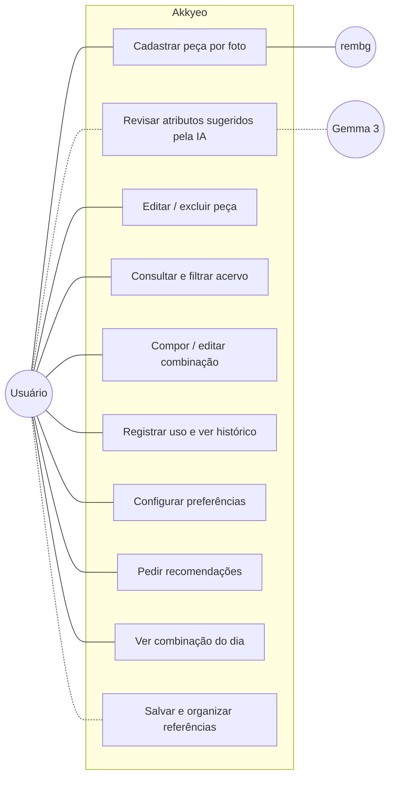
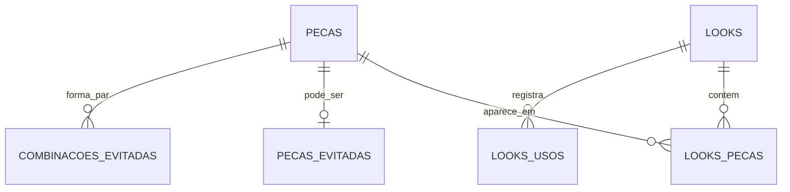
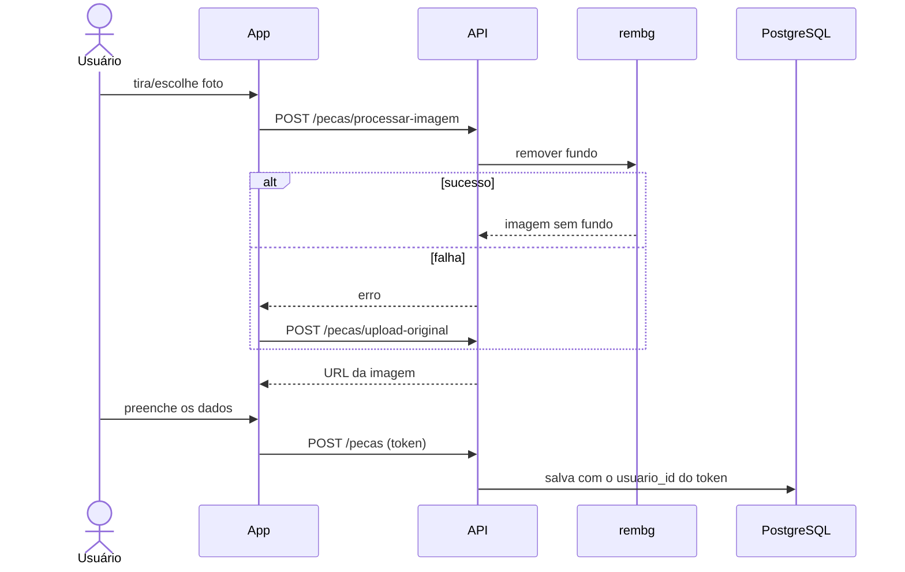
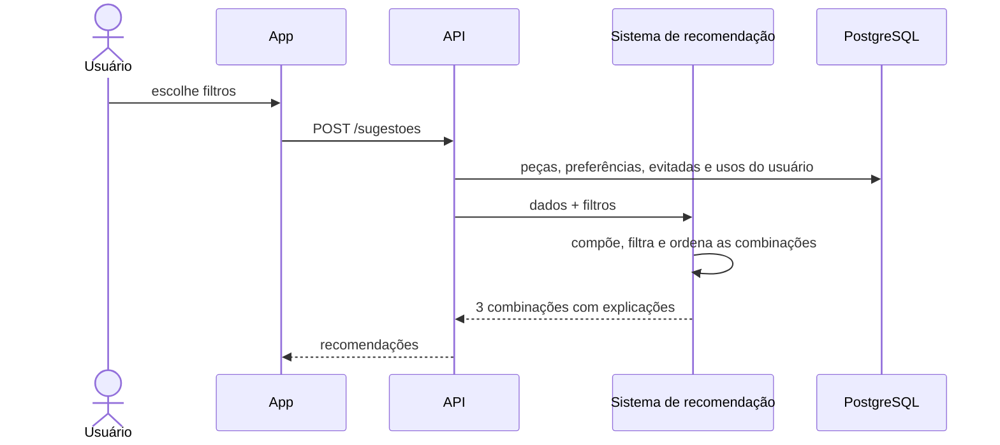
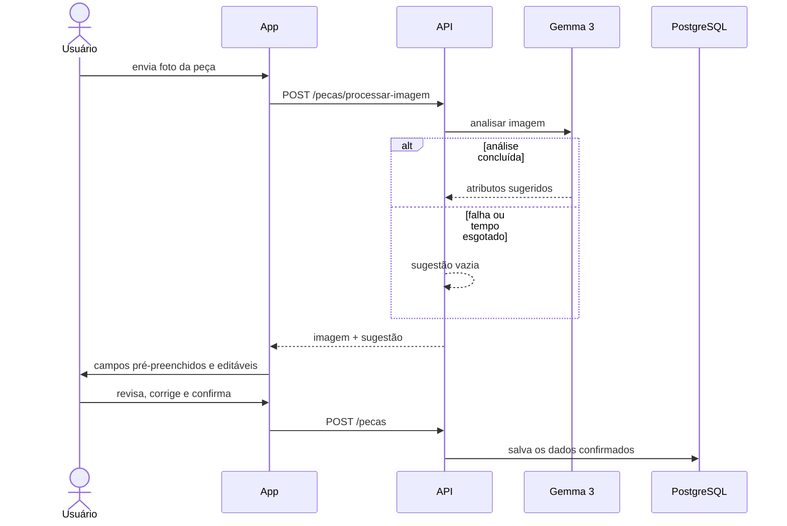

# Akkyeo — Assistente Inteligente de Estilo e Vestuário

**Aplicativo móvel para gestão do vestuário pessoal, com inteligência artificial e sistema de recomendação baseado em regras**

**Documento da Versão 2 (V2) do projeto**

Autora: Hannah Martins Pereira Vianna Lima — Matrícula: 202301135168
Curso: Engenharia de Computação — Centro Universitário Ibmec
Orientador: Álvaro
Data: outubro de 2026

---

## Resumo

Este documento descreve a segunda versão (V2) do Akkyeo — Assistente Inteligente de Estilo e Vestuário, um aplicativo móvel de gestão do vestuário pessoal. O Akkyeo parte de uma premissa simples: renovar a forma de se vestir não exige, necessariamente, renovar constantemente o que se possui. O aplicativo ajuda o usuário a catalogar e conhecer melhor o próprio acervo de roupas, a compor combinações considerando ocasião, compatibilidade de cores e preferências de estilo, e a redescobrir peças subutilizadas, incentivando uma relação mais consciente com o consumo de moda. O cadastro de cada peça é feito por fotografia, com remoção automática do fundo da imagem. As combinações são produzidas por um sistema de recomendação baseado em regras, que considera harmonia de cores, estrutura da combinação, preferências declaradas e histórico de uso, priorizando as peças menos usadas. O sistema foi construído com Flutter (aplicativo), FastAPI (servidor) e PostgreSQL (banco de dados). Como componente de inteligência artificial multimodal, está planejada a integração com o Gemma 3 para analisar a fotografia de cada peça e sugerir seus atributos visuais, que o usuário revisa antes de salvar. O trabalho também planeja uma avaliação com usuários para verificar se o aplicativo reduz o tempo de decisão e amplia o uso das peças existentes.

**Palavras-chave:** gestão do vestuário pessoal; consumo consciente; sistema de recomendação; inteligência artificial multimodal; aplicativo móvel; acessibilidade.

---

## 1 Introdução

### 1.1 Contexto e problema

A forma como as pessoas consomem e utilizam roupas mudou significativamente nas últimas décadas. O modelo de *fast fashion*, baseado em produção acelerada, preços baixos e renovação frequente de tendências, estimulou a aquisição contínua de novas peças. Segundo a Ellen MacArthur Foundation (2017), a produção mundial de roupas praticamente dobrou em quinze anos, enquanto a utilização de cada peça — o número médio de vezes que ela é usada antes de deixar de ser usada — caiu 36% no mesmo período. No Reino Unido, uma pesquisa da WRAP (2022) estimou que um adulto possui em média 118 peças no guarda-roupa e que cerca de um quarto delas (26%, ou 31 peças) não foi usado por pelo menos um ano.

Esses dados indicam que muitas pessoas utilizam apenas parte do vestuário que possuem. O problema decorre menos da falta de peças e mais da falta de visibilidade sobre o próprio acervo e do esforço envolvido em pensar em combinações no dia a dia. Peças esquecidas no armário representam recursos financeiros imobilizados, contribuem para compras que poderiam ser evitadas e ampliam o impacto ambiental associado à moda. Ao mesmo tempo, a decisão cotidiana sobre o que vestir consome tempo e atenção, sobretudo quando é preciso considerar ocasião, clima e compatibilidade entre as peças.

### 1.2 Proposta

O Akkyeo é um assistente de estilo e vestuário que apoia a gestão do vestuário pessoal. O usuário cadastra suas peças por fotografia e o aplicativo o ajuda a organizar o acervo, compor combinações para diferentes ocasiões e redescobrir peças pouco usadas. A proposta vai além da sugestão de combinações: o objetivo é que o usuário conheça melhor o que já possui e explore novas possibilidades com esse acervo, expressando o próprio estilo sem a necessidade de adquirir roupas constantemente.

A regra central do produto é que **o sistema nunca sugere nem exibe uma peça que o usuário não tenha cadastrado**. O Akkyeo não recomenda compras; ele trabalha exclusivamente com o vestuário que a pessoa já tem.

#### 1.2.1 O nome Akkyeo

O nome é inspirado na palavra coreana 아껴 (*akkyeo*), forma relacionada ao verbo 아끼다 (*akkida*), que pode expressar as ideias de economizar, valorizar e utilizar algo com cuidado, evitando desperdícios. O nome sintetiza a proposta do aplicativo: valorizar as roupas que já se possui, descobrir novas formas de usá-las e incentivar um consumo mais consciente. O complemento "Assistente Inteligente de Estilo e Vestuário" situa o produto como uma ferramenta tecnológica de apoio à organização, à decisão e à expressão pessoal, e não apenas como um catálogo de roupas.

### 1.3 Pergunta de pesquisa e hipótese

**Pergunta:** um aplicativo de gestão do vestuário pessoal, com recomendações de combinações que priorizam peças pouco usadas, reduz o tempo de decisão sobre o que vestir e amplia o uso das peças que a pessoa já possui?

**Hipótese:** ao usar o aplicativo por algumas semanas, os participantes (a) levam menos tempo para compor uma combinação e (b) usam um número maior de peças distintas do próprio acervo do que antes de usá-lo.

A forma de medir está descrita na seção 3.2.

### 1.4 Objetivos

**Objetivo geral:** desenvolver um aplicativo móvel de gestão do vestuário pessoal que apoie o usuário a organizar, conhecer e aproveitar melhor as roupas que já possui, combinando um sistema de recomendação baseado em regras com inteligência artificial multimodal para o cadastro das peças, e avaliar sua contribuição junto a usuários reais.

**Objetivos específicos**, relacionados às funcionalidades que os concretizam:

| Objetivo | Funcionalidade correspondente | Situação |
| --- | --- | --- |
| Ajudar o usuário a organizar e conhecer o próprio acervo | Cadastro de peças por foto, com remoção de fundo; armário organizado por categorias, com filtros | Implementado |
| Reduzir o trabalho manual de catalogação | Cadastro assistido por IA (Gemma 3), com revisão pelo usuário | Planejado para a versão inicial |
| Facilitar as decisões cotidianas sobre o que vestir | Recomendação de combinações por regras; combinação do dia na tela inicial | Implementado |
| Considerar ocasiões, contextos e compatibilidade de cores | Filtros de ocasião, estação e cor; regras de harmonia cromática no sistema de recomendação | Implementado |
| Incentivar o aproveitamento das peças e reduzir sua subutilização | Prioridade para peças pouco usadas e esquecidas; registro e histórico de uso | Implementado |
| Apoiar a descoberta e a expressão do estilo pessoal, sem impor padrões estéticos | Preferências de estilo, combinações de cores favoritas, peças evitadas e nível de criatividade definidos pelo próprio usuário; mural de referências visuais | Preferências: implementado. Mural: planejado |
| Considerar acessibilidade e diferentes necessidades | Recursos básicos de acessibilidade, com ênfase em não depender apenas de cor para transmitir informação | Planejado (requisito transversal) |
| Verificar a efetividade da proposta | Avaliação com usuários (tempo de decisão, variedade de peças usadas, usabilidade e satisfação) | Planejado |

### 1.5 Justificativa

A justificativa do Akkyeo apoia-se em três dimensões.

**Relevância cotidiana.** Decidir o que vestir é uma tarefa diária, que envolve lembrar o que se possui, avaliar a adequação à ocasião e combinar cores e peças. Quando o acervo é pouco visível, essa tarefa tende a se resolver pela repetição das mesmas peças, enquanto outras permanecem esquecidas. Reduzir o esforço envolvido nessas escolhas pode tornar a experiência mais prática e acessível, especialmente para quem dispõe de pouco tempo.

**Consumo consciente.** Aumentar o número de vezes que cada peça é usada é uma das principais estratégias apontadas pela Ellen MacArthur Foundation (2017) para reduzir o desperdício na indústria da moda. No contexto do *fast fashion*, uma ferramenta que ajuda a pessoa a explorar novas possibilidades com o que já possui oferece uma alternativa à renovação constante do guarda-roupa. Espera-se que o uso do aplicativo amplie o aproveitamento das peças existentes; se isso se traduz em menos compras ou em impacto ambiental mensurável são questões que não se pretende afirmar de antemão, mas que podem ser avaliadas.

**Relevância para a Engenharia de Computação.** O projeto integra, em uma aplicação real, conteúdos centrais da formação: desenvolvimento móvel multiplataforma, integração entre aplicação e API, modelagem relacional e migrações de banco de dados, segurança e isolamento de dados por usuário, processamento de imagens e um sistema de recomendação com critérios explícitos e testáveis. Soma-se a isso o uso de inteligência artificial multimodal — o Gemma 3, capaz de interpretar imagens — para apoiar o cadastro das peças. O projeto foi concebido para que o sucesso não dependa de a IA executar todas as funções: o reconhecimento de imagens reduz o trabalho de catalogação, enquanto a recomendação permanece em um sistema determinístico, verificável por testes automatizados (seção 2.5).

### 1.6 Público-alvo

Público geral. Como referência para as decisões de projeto, foi criada a persona *Marina*, 29 anos, que trabalha em horário comercial, tem pouco tempo e sente que "sempre usa as mesmas cinco peças". Ela valoriza rapidez e praticidade e não quer comprar roupas novas apenas para ter o que vestir.

Por se destinar ao público geral, o projeto considera também usuários com diferentes necessidades, em especial pessoas com daltonismo ou dificuldade para distinguir determinadas cores, para quem um aplicativo centrado em combinações cromáticas precisa oferecer informação que não dependa apenas da percepção visual das cores (seção 5.10).

### 1.7 Resultados esperados

- protótipo funcional (aplicativo, API e banco) que demonstre o fluxo cadastro → acervo → combinação → recomendação;
- cadastro assistido pelo Gemma 3, com sugestões de atributos revisáveis pelo usuário;
- sistema de recomendação coberto por testes automatizados que comprovem suas regras;
- garantia, verificada por teste, de que nenhum dado de um usuário aparece para outro;
- recursos básicos de acessibilidade aplicados à interface;
- resultados da avaliação com usuários que confirmem ou refutem a hipótese da seção 1.3;
- documentação técnica suficiente para outra pessoa entender e evoluir o sistema.

Como benefícios esperados — cuja efetividade será objeto de avaliação, e não pressuposto —, destacam-se: maior conhecimento do usuário sobre o próprio acervo, decisões cotidianas mais rápidas, maior variedade de peças efetivamente usadas e estímulo à experimentação de novas combinações.

### 1.8 Escopo: implementado, planejado e evolução futura

Para evitar ambiguidade sobre o estado do projeto, as funcionalidades são classificadas em três grupos:

| Grupo | Funcionalidades |
| --- | --- |
| **Implementado** | Cadastro de peças por foto com remoção de fundo; organização e filtros do acervo; composição manual de combinações, favoritos, ocasiões e histórico de uso; preferências de estilo; recomendação de combinações por regras; combinação do dia. |
| **Planejado para a versão inicial** | Cadastro assistido pelo Gemma 3 (Épico 7, seção 5.8); mural de referências visuais com importação de imagens (Épico 8, primeira etapa, seção 5.9); recursos básicos de acessibilidade (seção 5.10); login real, armazenamento em nuvem e avaliação com usuários (seção 8). |
| **Evolução futura** | Assistente conversacional; comparação automatizada entre referências e peças cadastradas (Épico 8, segunda etapa); identificação automática das roupas presentes nas referências; integração direta com o Pinterest; clima em tempo real (seção 9). |

---

## 2 Revisão teórica e fundamentação tecnológica

### 2.1 Trabalhos relacionados

Existem diversos aplicativos de guarda-roupa digital no mercado. O quadro a seguir resume os principais, a partir das informações divulgadas pelos próprios desenvolvedores (lojas de aplicativos e sites oficiais, consultados em outubro de 2026). O Whering foi tomado como principal referência, por ser o mais próximo da proposta do Akkyeo.

| Aplicativo | Proposta | Recursos principais | Uso de IA | Modelo de cobrança |
| --- | --- | --- | --- | --- |
| **Whering** (principal) | Guarda-roupa digital, planejador de looks e "estilista" | Catalogação por foto com remoção de fundo; sugestões de looks por ocasião; embaralhamento de peças em novas combinações; *moodboards*; listas de viagem; custo por uso; marketplace | Categorização das peças e sugestões de looks | Gratuito, com ações de IA pagas por créditos |
| **Acloset** | Assistente de moda com IA | Remoção de fundo e extração de atributos da foto; importação de lojas on-line; "look do dia" considerando clima e agenda; calendário; custo por uso; análise de coloração pessoal; comunidade | Extração de atributos e recomendação de looks | Gratuito até 100 peças; assinatura acima disso |
| **GetWardrobe** | Guarda-roupa organizado por IA | Remoção de fundo e identificação de categoria e cor; editor de looks em colagem; calendário com clima; estatísticas de uso; listas de viagem; perfis familiares | Identificação das peças e geração de looks por estação, clima e ocasião | Gratuito até 100 peças e looks; plano Premium |
| **Fits** | Guarda-roupa digital e planejador de looks | Detecção de tipo, cor, categoria e marca; criação de looks por colagem; calendário; estatísticas de uso; listas de desejos e de viagem | Detecção de atributos e "estilista" com sugestões e conversa | Gratuito, com plano Pro |
| **Combyne** | Comunidade de moda para criar e compartilhar looks | Colagens combinando peças próprias e de lojas parceiras; *feed*, desafios e *moodboards*; compra integrada | Não é o foco do produto | Gratuito, com assinatura opcional |
| **Modesona** | [confirmar] | [confirmar] | [confirmar] | [confirmar] |

Observa-se que a catalogação por foto e a geração de combinações por IA são recursos comuns no mercado. Também é frequente a integração com compras (marketplaces, lojas parceiras, listas de desejos), o que se afasta do objetivo de aproveitar o vestuário existente. Nas informações consultadas, não foram encontrados recursos de acessibilidade voltados a pessoas com dificuldade de distinguir cores [confirmar testando os aplicativos].

O diferencial do Akkyeo é reunir: recomendações restritas às peças cadastradas; recomendações explicáveis, geradas por regras documentadas; prioridade explícita para peças pouco usadas, a partir do histórico real de uso; IA aplicada ao cadastro, sempre sob revisão do usuário; e atenção à acessibilidade em um domínio fortemente baseado em cores.

### 2.2 Sistemas de recomendação

Sistemas de recomendação costumam ser divididos em filtragem colaborativa (usa o comportamento de muitos usuários), baseados em conteúdo (usam atributos dos itens) e baseados em conhecimento (usam regras explícitas do domínio) (BURKE, 2002; RICCI; ROKACH; SHAPIRA, 2015). O Akkyeo usa a abordagem **baseada em conhecimento**: não precisa de dados de outros usuários para começar a funcionar e permite explicar cada recomendação.

### 2.3 Harmonia de cores

A teoria clássica organiza as cores em um círculo cromático e descreve combinações harmônicas: monocromáticas (mesma cor), análogas (cores vizinhas) e complementares (cores opostas), além do uso de neutros (ITTEN, 1970). O sistema de recomendação transforma essa ideia em uma medida de "ousadia" entre duas cores, conforme a distância entre elas no círculo (seção 5.4).

### 2.4 Remoção de fundo

Remover o fundo de uma foto é um problema de segmentação: separar o objeto principal do restante da imagem. A biblioteca `rembg` usa, por padrão, a rede neural U²-Net (QIN et al., 2020), que gera uma máscara da peça e permite salvá-la com fundo transparente.

### 2.5 Inteligência artificial no Akkyeo: reconhecimento de imagem e recomendação

O Akkyeo emprega duas funções distintas, que não devem ser confundidas:

| | Reconhecimento de imagem (Gemma 3) | Sistema de recomendação (regras) |
| --- | --- | --- |
| **Pergunta que responde** | "Que peça é esta e quais são suas características visuais?" | "Quais peças do acervo combinam entre si para esta ocasião?" |
| **Entrada** | A fotografia de uma peça | Os atributos das peças cadastradas, as preferências do usuário e o histórico de uso |
| **Saída** | Sugestão de atributos (categoria, cores e outras características identificáveis) | Combinações ordenadas, com explicação |
| **Natureza** | Probabilística: pode errar, por isso o resultado é sempre revisado pelo usuário | Determinística: a mesma entrada produz sempre o mesmo resultado, verificável por testes |
| **Situação** | Planejado para a versão inicial | Implementado |

O Gemma 3 é uma família de modelos de pesos abertos desenvolvida pelo Google, cujas versões a partir de 4 bilhões de parâmetros aceitam imagens como entrada (GEMMA TEAM, 2025). O Akkyeo usa a versão de 4 bilhões de parâmetros (`gemma3:4b`), executada localmente pelo Ollama, ferramenta que roda modelos de IA no próprio computador e os disponibiliza por uma API HTTP local (OLLAMA, 2026). No Akkyeo, sua função é **classificar visualmente as peças** durante o cadastro, reduzindo o trabalho manual de catalogação. Nesta versão, o Gemma 3 **não decide quais combinações recomendar**: essa responsabilidade permanece no sistema de regras, que usa os atributos das peças (preenchidos ou confirmados pelo usuário), a compatibilidade de cores e as preferências declaradas.

Essa separação traz duas vantagens. Primeiro, a recomendação continua explicável e testável, independentemente da disponibilidade ou do comportamento do modelo de IA. Segundo, os dois componentes se reforçam: quanto mais completos e corretos os atributos das peças — o que o cadastro assistido facilita —, melhores tendem a ser as combinações produzidas pelo sistema de regras.

### 2.6 Tecnologias utilizadas

Esta seção resume as tecnologias usadas e o motivo de cada escolha.

| Camada | Tecnologia | Motivo da escolha |
| --- | --- | --- |
| Aplicativo | Flutter (Dart) | Um único código para Android e iOS, com acesso à câmera do celular. |
| Servidor (API) | FastAPI (Python) | Rápido, assíncrono e com validação automática de dados; integra-se bem com bibliotecas de visão computacional. |
| Banco de dados | PostgreSQL com extensão `pgvector` | Banco relacional consolidado; o `pgvector` permitirá, no futuro, buscas por similaridade de imagens sem um segundo banco. |
| Acesso ao banco | SQLAlchemy 2.0 e Alembic | Modelagem tipada e migrações versionadas, sem alterar o banco "na mão". |
| Remoção de fundo | `rembg` | Roda localmente, sem custo por imagem. |
| Análise visual das peças (planejada) | Gemma 3 4B (Google), executado localmente pelo Ollama | Modelo de pesos abertos, com download de 3,4 GB, que aceita imagens e roda no próprio computador, sem custo por uso e sem enviar as fotos a terceiros. Foi escolhido no lugar do Llama 4 Scout, cujo download de 67 GB excede a memória do notebook de desenvolvimento (32 GB de RAM e 4 GB de VRAM). O ponto de integração já existe no fluxo de cadastro; a chamada real ao modelo ainda não foi implementada. |
| Autenticação (planejada) | Supabase Auth | Evita construir do zero o controle de senhas e sessões. Por enquanto é usado um token de teste. |
| Ambiente local | Docker Compose | Sobe o banco igual para qualquer pessoa que clone o projeto. |

**Por que recomendação por regras, e não por aprendizado de máquina.** O sistema de recomendação usa regras explícitas (harmonia de cores, estrutura da combinação, preferências), e não um modelo treinado. Os motivos são: não há dados de uso para treinar um modelo no início; as regras podem ser explicadas ao usuário; e o resultado é sempre o mesmo para a mesma entrada, o que permite testá-lo automaticamente.

---

## 3 Metodologia

### 3.1 Desenvolvimento

O projeto foi conduzido de forma incremental, com ciclos curtos inspirados em métodos ágeis:

1. **Documentação inicial:** definição de visão, requisitos e arquitetura (arquivos `visao.md`, `requisitos.md` e `arquitetura.md`).
2. **Divisão em itens pequenos:** cada funcionalidade foi quebrada em PBIs (*Product Backlog Items*), com descrição, critérios de aceite e dependências (arquivo `backlog.md`). A numeração segue o padrão `E<épico>.F<feature>.<item>`.
3. **Regras antes do código:** as regras do sistema de recomendação foram escritas e aprovadas antes da implementação (arquivo `regras-sugestoes.md`).
4. **Implementação e verificação:** cada PBI foi implementada e verificada com análise estática (`dart analyze`), testes automatizados (`flutter test` e `pytest`) e, nas rotas do servidor, execução real da API contra o banco.
5. **Registro honesto de status:** cada PBI registra o que foi realmente verificado e o que ainda está pendente, diferenciando "implementado" de "validado".

Parte do código foi escrita com apoio de um assistente de programação com IA (Claude Code). As decisões de escopo, regras e arquitetura foram tomadas pela autora e estão registradas nos documentos do projeto; a ferramenta implementava apenas itens já especificados, e nenhum item foi dado como concluído sem verificação.

O desenvolvimento começou em agosto de 2026 e esta V2 reflete o estado do projeto em outubro de 2026. O código é versionado em Git.

### 3.2 Avaliação com usuários (planejada)

Para responder à pergunta da seção 1.3, será feito um teste com **5 a 10 pessoas** durante **2 a 4 semanas**.

| Métrica | Como medir |
| --- | --- |
| Tempo para compor uma combinação | Cronometrado em uma tarefa padronizada ("monte uma combinação para o trabalho"), no início e no fim do teste. |
| Variedade de peças usadas | Número de peças distintas usadas no período, a partir dos registros de uso do próprio aplicativo; comparado com o que o participante relatar sobre as semanas anteriores. |
| Usabilidade | Questionário SUS (*System Usability Scale*), com 10 perguntas, aplicado no fim do teste (BROOKE, 1996). |
| Satisfação | Questionário curto com perguntas sobre utilidade das recomendações e intenção de continuar usando. |

O aplicativo já registra cada uso de combinação com data, então a variedade de peças usadas pode ser extraída do banco sem trabalho extra do participante. Para o teste acontecer, o aplicativo precisa estar acessível fora da máquina de desenvolvimento, com login real (seção 8).

[Definir com o orientador: número de participantes, duração e se haverá uma semana inicial sem recomendações para comparação.]

---

## 4 Requisitos

Os requisitos completos estão em `docs/requisitos.md`. Aqui estão os principais, divididos em épicos.

### 4.1 Requisitos funcionais

| Épico | Descrição | Situação |
| --- | --- | --- |
| 1 — Cadastro de roupas | Adicionar peça por foto com remoção de fundo; preencher atributos; editar e excluir. | Implementado |
| 2 — Organização | Listar o acervo por categoria; filtrar por cor, estação e ocasião. | Implementado |
| 3 — Looks manuais | Compor, editar e excluir looks; favoritar; organizar por ocasião; registrar uso e ver histórico. | Implementado |
| 4 — Preferências de estilo | Cores que combinam, estilos, sobreposições, peças e combinações evitadas, nível de criatividade. | Implementado |
| 5 — Sugestões sob demanda | Looks recomendados por regras, com filtros, a partir de uma peça, priorizando peças pouco usadas. | Implementado |
| 6 — Look do dia | Recomendação automática na tela inicial, variando conforme o histórico de uso. | Implementado (sem clima real) |
| 7 — Cadastro assistido por IA | Sugestão de categoria, cores e outras características a partir da foto, via Gemma 3, sempre revisável. | Planejado para a versão inicial |
| 8 — Inspiração por imagem | **Mural de referências:** importar, salvar e organizar imagens de referência dentro do aplicativo. | Planejado para a versão inicial |
| 8 — Inspiração por imagem | **Análise automatizada:** recriar uma referência com peças do próprio acervo, explicitando lacunas. | Evolução futura |

### 4.2 Requisitos não funcionais

- **Privacidade:** todo dado pertence a um usuário. O identificador do usuário vem do token de autenticação e nunca do corpo da requisição, e um usuário não acessa dados de outro.
- **Restrição ao acervo:** nenhuma recomendação contém peça não cadastrada pelo usuário.
- **Reprodutibilidade:** a mesma entrada gera sempre as mesmas recomendações.
- **Desempenho:** recomendações para um acervo de 100 peças em menos de 1 segundo (medido: 0,62 s).
- **Idioma:** interface em português; código e nomes técnicos em inglês.
- **Resiliência:** uma falha em serviço de IA não pode interromper o fluxo do usuário. Se a remoção de fundo falhar, o usuário pode seguir com a foto original; se a análise pelo Gemma 3 falhar, os campos aparecem vazios para preenchimento manual.
- **Controle do usuário sobre a IA:** nenhum atributo sugerido pelo Gemma 3 é salvo sem revisão e confirmação do usuário.
- **Acessibilidade:** informações importantes não devem ser transmitidas apenas por cor; textos e contrastes devem ser legíveis e os elementos interativos devem ter rótulos compreensíveis (seção 5.10).

### 4.3 Fora do escopo

Recomendação de compras, rede social, múltiplos idiomas, aprendizado de estilo avançado, sincronização em tempo real entre dispositivos e identificação do tipo de daltonismo do usuário.

---

## 5 Arquitetura do sistema

O sistema tem três partes principais: o **aplicativo Flutter**, a **API FastAPI** e o **banco PostgreSQL**. Toda a regra de negócio fica na API, nunca no aplicativo.

```
App Flutter  --HTTP + token-->  API FastAPI  -->  PostgreSQL (+ pgvector)
                                    |
                                    +--> sistema de recomendação (regras)
                                    +--> rembg (remoção de fundo)
                                    +--> armazenamento de imagens (pasta local)
                                    +--> Gemma 3 (análise visual das peças — planejado)
```

### 5.1 Organização do servidor e padrões de projeto

O servidor é dividido em camadas, para que partes que podem mudar (como o serviço de visão ou o armazenamento) sejam trocadas sem alterar o restante:

- **api/v1 (rotas):** recebem as requisições HTTP e validam os dados. Não chamam `rembg` ou IA diretamente.
- **services:** regras de negócio, incluindo o sistema de recomendação.
- **adapters:** comunicação com `rembg`, armazenamento e Gemma 3.
- **db (models):** tabelas do banco, em SQLAlchemy.
- **schemas:** formatos de entrada e saída dos dados, em Pydantic.

Essa organização segue padrões de projeto conhecidos (GAMMA et al., 1994; FOWLER, 2002):

| Padrão | Onde aparece | Para que serve |
| --- | --- | --- |
| Arquitetura em camadas | rotas → serviços → adaptadores/banco | Cada parte tem uma responsabilidade; mudar uma não obriga a mudar as outras. |
| Camada de serviço (*Service Layer*) | `services/` | A lógica fica fora das rotas e pode ser testada sem servidor nem banco. |
| Adaptador (*Adapter*) | `adapters/` | Trocar o armazenamento local por nuvem, ou o provedor de IA, muda só o adaptador. |
| Injeção de dependência | `Depends` do FastAPI | O usuário sempre vem do token; nos testes, as dependências são substituídas. |
| Exclusão lógica | campo `arquivado` nas combinações | Excluir uma combinação não apaga o histórico de uso dela. |

### 5.2 Organização do aplicativo

O aplicativo é organizado em `core` (tema, constantes e comunicação com a API), `models`, `services` (um por recurso, chamam a API) e `views` (telas e seus controladores de estado, com Riverpod). As telas não falam diretamente com a API, o que permite testá-las com serviços falsos.

### 5.3 Fluxo de cadastro de uma peça (implementado)

1. O usuário tira uma foto ou escolhe uma da galeria e vê uma pré-visualização.
2. O aplicativo envia a foto para `POST /pecas/processar-imagem`.
3. A API remove o fundo com `rembg`, salva a imagem e devolve a URL.
4. O aplicativo mostra o resultado. Se o processamento falhar, oferece continuar com a foto original (`POST /pecas/upload-original`).
5. O usuário preenche categoria, cor, tonalidade, estação, ocasiões, estilo e modelagem (apenas a categoria é obrigatória).
6. O aplicativo envia os dados para `POST /pecas`, e a peça é salva no banco.

### 5.4 Sistema de recomendação

As regras completas estão em `docs/regras-sugestoes.md`. Em resumo:

1. **Estrutura:** parte de cima + parte de baixo + sapato, ou vestido + sapato. Casaco só no outono/inverno ou se o usuário gosta de sobreposições.
2. **Cores:** cada par de peças recebe uma "ousadia" de 0 a 4, conforme a distância das cores no círculo cromático (neutros e mesma cor = 0; cores opostas = 4). A combinação só entra se a ousadia couber no nível de criatividade escolhido pelo usuário.
3. **Restrições:** filtros de ocasião, estilo, estação e cor; peças e combinações evitadas nunca entram.
4. **Ordenação:** combinações de cor favoritas, cadastro completo, estilos preferidos e **peças menos usadas** vêm primeiro.
5. **Combinação do dia:** usa o mesmo sistema, priorizando peças esquecidas (sem uso há mais de 30 dias).

Cada recomendação mostra o motivo e avisos como "falta calçado" ou "cadastro incompleto". O nível de criatividade e as preferências são definidos pelo próprio usuário, de modo que o sistema estimula a experimentação sem impor um padrão estético único.

### 5.5 Modelo de dados

| Tabela | Principais campos |
| --- | --- |
| `pecas` | id, usuario_id, imagem_url, categoria, subcategoria, cor_principal, tonalidade_cor, estacao, ocasioes, estilo, modelagem, criado_em |
| `looks` | id, usuario_id, nome, favorito, ocasioes, arquivado, criado_em |
| `looks_pecas` | associação N:N entre combinações e peças |
| `looks_usos` | id, look_id, usuario_id, usado_em |
| `preferencias` | usuario_id, estilos, sobreposicoes, combinacoes_cores, criatividade, ocasiao_look_do_dia |
| `pecas_evitadas` / `combinacoes_evitadas` | peças e pares que o usuário não quer nas recomendações |

As tabelas foram criadas por 11 migrações do Alembic (`0001_initial` a `0011_look_arquivado`). A primeira também habilita a extensão `pgvector`, que ainda não é usada pela aplicação. Os nomes técnicos das tabelas (como `looks`) foram mantidos conforme o código.

### 5.6 Rotas da API

Todas sob `/api/v1`, exigem token de autenticação e filtram os dados pelo usuário dele. Tentar usar uma peça de outro usuário resulta em erro, sem revelar que a peça existe.

| Recurso | Rotas |
| --- | --- |
| Peças | `POST /pecas/processar-imagem`, `POST /pecas/upload-original`, `POST /pecas`, `GET /pecas`, `PUT /pecas/{id}`, `DELETE /pecas/{id}` |
| Combinações | `POST /looks`, `GET /looks`, `PATCH /looks/{id}`, `DELETE /looks/{id}`, `POST /looks/{id}/usos`, `GET /looks/historico`, `DELETE /looks/usos/{id}` |
| Preferências | `GET /preferencias`, `PATCH /preferencias`, rotas de peças e combinações evitadas |
| Recomendações | `POST /sugestoes`, `POST /sugestoes/look-do-dia` |

### 5.7 Modelagens

Os diagramas abaixo estão em Mermaid e serão exportados como figuras no documento final.

**Modelagem funcional — casos de uso.** O ator principal é o usuário; o `rembg` participa do cadastro. Os casos de uso tracejados estão planejados.



**Modelagem estática — modelo de dados.**



Todas as tabelas têm `usuario_id`; a tabela `preferencias` tem uma linha por usuário. Os campos de cada tabela estão na seção 5.5.

**Modelagem dinâmica — cadastro de peça (implementado).**



**Modelagem dinâmica — pedido de recomendações (implementado).**



### 5.8 Cadastro assistido pelo Gemma 3 (planejado para a versão inicial)

O cadastro assistido é a primeira aplicação de inteligência artificial do Akkyeo. O fluxo esperado é:

1. O usuário seleciona ou envia uma fotografia de uma peça de roupa.
2. O Gemma 3 analisa visualmente a imagem.
3. O modelo sugere informações como categoria da peça, cores e outras características visuais que possam ser identificadas com razoável confiabilidade.
4. O aplicativo apresenta os dados sugeridos para o usuário revisar e corrigir.
5. Após a confirmação, as informações são salvas no cadastro da peça.



**Estado atual.** O fluxo de cadastro já foi construído prevendo essa etapa: o serviço de processamento de imagem chama um adaptador de análise visual e devolve ao aplicativo um campo de sugestão. Hoje esse adaptador retorna uma sugestão vazia, e o usuário preenche os atributos manualmente. A implementação consiste em fazer a chamada real ao modelo e exibir a sugestão no formulário.

**Princípios.** As respostas do modelo não são tratadas como infalíveis: toda característica identificada pode ser revisada e corrigida, e nada é salvo sem confirmação do usuário. A chamada ao modelo deve ter tempo limite e alternativa em caso de falha, para que o cadastro nunca dependa da disponibilidade da IA. Detalhes como a versão do modelo, o formato exato da resposta e os custos de uso ainda serão definidos durante a implementação.

### 5.9 Mural de referências visuais (Épico 8 — planejado para a versão inicial)

Inspirado no conceito de murais de referências, semelhante à organização visual encontrada no Pinterest, o mural permitirá ao usuário reunir imagens de roupas, estilos e combinações que considere interessantes, e utilizá-las como ponto de partida para explorar possibilidades com as peças que já possui.

Para manter o escopo viável, a primeira versão prevê **importar ou salvar imagens de referência dentro do próprio aplicativo**, organizando-as para consulta. Não está prevista integração direta com a API do Pinterest. Nesta etapa, a relação entre a referência e o acervo é feita pelo próprio usuário, que consulta a imagem e compõe a combinação com suas peças.

A comparação automatizada entre uma referência e as peças cadastradas, bem como a identificação automática das roupas presentes na imagem, aumentam consideravelmente a complexidade e são tratadas como evolução futura, na segunda etapa do Épico 8 (seção 9).

### 5.10 Acessibilidade

Como o Akkyeo trabalha intensamente com cores, a acessibilidade é tratada como preocupação de projeto, com atenção especial a pessoas com daltonismo ou dificuldade para distinguir determinadas cores. O princípio adotado é **não depender exclusivamente de estímulos visuais para transmitir informações importantes**, alinhado às diretrizes de acessibilidade para conteúdo web (W3C, 2023).

Os recursos considerados são simples e viáveis:

- exibir o nome da cor em texto junto à sua representação visual;
- não utilizar apenas cores para indicar seleção, erros, filtros ativos ou outras informações importantes, combinando-as com ícones, texto ou formas;
- manter contraste adequado e textos legíveis;
- utilizar rótulos compreensíveis, considerar o uso de leitores de tela e garantir áreas de toque adequadas.

Parte disso já está presente: os seletores de cor do cadastro e dos filtros de recomendação apresentam as cores pelo nome. A revisão sistemática da interface segundo esses critérios está planejada e será priorizada conforme a viabilidade técnica. Não faz parte do escopo identificar o tipo de daltonismo do usuário nem realizar análise especializada de cores.

---

## 6 Desenvolvimento e resultados da V2

### 6.1 Funcionalidades entregues

**Cadastro de peças.** O usuário captura ou escolhe uma foto, vê a prévia, envia para processamento e confirma o resultado. Em seguida, preenche os atributos da peça. Quando ocorre erro, o aplicativo mostra uma mensagem clara e permite continuar com a foto original.

**Acervo.** As peças aparecem agrupadas por categoria, com filtros por cor, estação e ocasião. Peças com cadastro incompleto recebem um selo. Ao tocar numa peça, abre-se o detalhe, de onde é possível editar, excluir ou pedir recomendações a partir dela.

**Combinações.** O usuário compõe combinações com peças do próprio acervo, dá nome, escolhe ocasiões, favorita, edita e exclui. Pode marcar "usei hoje" (ou outra data), ver o histórico em um calendário e recebe um aviso quando uma combinação foi usada há poucos dias.

**Preferências de estilo.** Combinações de cores que o usuário aprecia, estilos preferidos, sobreposições, peças e combinações a evitar e nível de criatividade das combinações.

**Recomendações.** Uma aba mostra três combinações recomendadas por vez, com filtros, opção de ver outras, descartar e salvar. Na tela inicial, um card de "combinação do dia" sugere uma composição que privilegia peças esquecidas.

**Identidade visual.** O aplicativo foi redesenhado a partir de um protótipo no Figma, com navegação inferior em abas.

### 6.2 Resumo do andamento (backlog)

Foram detalhadas **41 PBIs**, das quais 40 estão implementadas e 1 não foi iniciada (E1.F1.5, testes automatizados das rotas de imagem). A lista completa está em `docs/backlog.md`. Os Épicos 7 (cadastro assistido pelo Gemma 3) e 8 (mural de referências) ainda não foram detalhados em PBIs.

| Épico | PBIs | Situação |
| --- | --- | --- |
| 1 — Cadastro de roupas | 7 | 6 concluídas, 1 não iniciada |
| 2 — Organização | 2 | Concluídas |
| 3 — Looks manuais | 14 | Concluídas |
| 4 — Preferências de estilo | 8 | Concluídas |
| 5 — Sugestões sob demanda | 7 | Concluídas |
| 6 — Look do dia | 3 | Concluídas |

### 6.3 Verificação realizada

- **Servidor:** 93 testes automatizados (`pytest`) cobrindo as regras do sistema de recomendação, todos passando (execução de 23/10/2026).
- **Aplicativo:** 242 testes automatizados (`flutter test`), todos passando (execução de 23/10/2026). As 3 falhas registradas na V1 foram resolvidas.
- **Execução real:** 8 PBIs de servidor foram testadas com a API rodando contra um PostgreSQL local, com dois usuários de teste, confirmando que um não acessa os dados do outro.
- **Desempenho:** recomendações para um acervo de 100 peças geradas em 0,62 s.
- **Teste preliminar do modelo de visão:** fora do aplicativo, o Gemma 3 4B, rodando pelo Ollama no notebook de desenvolvimento, classificou corretamente a foto de uma camiseta roxa (categoria, cor e tonalidade, dentro das listas do aplicativo), em cerca de 3 s com o modelo já carregado e 17,5 s na primeira chamada, dividindo o processamento entre CPU e GPU. Também mostrou um limite a tratar na implementação: no campo de subcategoria, repetiu o texto da instrução em vez de descrever a peça.
- Nesse processo foram encontrados e corrigidos erros reais, como uma falha de serialização na criação de combinações e um valor nulo que gerava erro de banco em vez de uma mensagem de validação.

---

## 7 Limitações da V2

1. **Sem login real.** A autenticação com Supabase ainda não foi integrada; os testes usam um token gerado localmente.
2. **Cadastro assistido ainda não integrado.** O ponto de integração com o Gemma 3 existe, mas a chamada real ao modelo não foi implementada; os atributos são preenchidos manualmente.
3. **Mural de referências e revisão de acessibilidade não iniciados.**
4. **Validação manual pendente.** O fluxo completo (celular ou navegador com a API real) ainda precisa ser testado de ponta a ponta por uma pessoa.
5. **Avaliação com usuários não realizada.** A hipótese da seção 1.3 ainda não foi testada.
6. **Armazenamento local.** As imagens ficam numa pasta do servidor. Para o teste com usuários será preciso migrar para um serviço de nuvem.
7. **Sem clima real.** A estação é escolhida pelo usuário; a previsão do tempo não é consultada.

---

## 8 Próximos passos

1. Validar manualmente o fluxo completo e corrigir o que aparecer.
2. Implementar o cadastro assistido pelo Gemma 3 (Épico 7), com revisão obrigatória pelo usuário, tempo limite e alternativa em caso de falha.
3. Revisar a interface segundo os critérios básicos de acessibilidade (seção 5.10).
4. Implementar o mural de referências (Épico 8, primeira etapa), com importação e organização de imagens (seção 5.9).
5. Integrar o login real com Supabase Auth e mover as imagens para armazenamento em nuvem.
6. Publicar o aplicativo em um ambiente acessível aos participantes.
7. Realizar a avaliação com usuários (seção 3.2) e analisar os resultados.

### 8.1 Cronograma

| Período | Atividade | Situação |
| --- | --- | --- |
| Ago/2026 | Visão, requisitos, arquitetura e estrutura do projeto | Concluído |
| Set/2026 | Cadastro de peças e organização do acervo (Épicos 1 e 2) | Concluído |
| Set–Out/2026 | Looks e preferências de estilo (Épicos 3 e 4) | Concluído |
| Out/2026 | Sistema de recomendação e look do dia (Épicos 5 e 6) | Concluído |
| [semana 1 após a reunião] | Validação manual de ponta a ponta e correções | Planejado |
| [semanas 2–3] | Cadastro assistido pelo Gemma 3 (Épico 7) e revisão de acessibilidade | Planejado |
| [semana 4] | Mural de referências (Épico 8, primeira etapa) | Planejado |
| [semana 5] | Login real, armazenamento em nuvem e publicação do aplicativo | Planejado |
| [semanas 6–8] | Avaliação com usuários e análise dos resultados | Planejado |
| [data] | Relatório técnico no modelo institucional (ABNT) e apresentação | Planejado |
| [defesa − 7 dias] | Envio do relatório à banca | Planejado |
| [data da defesa] | Defesa | Planejado |
| [defesa + 7 dias] | Versão final com os ajustes da banca e ficha catalográfica | Planejado |

---

## 9 Evoluções futuras

As funcionalidades desta seção **não fazem parte do escopo da versão inicial** e não são requisitos obrigatórios do TCC. Elas indicam caminhos de evolução do Akkyeo após a consolidação das funcionalidades planejadas.

**Assistente conversacional.** Um assistente com o qual o usuário possa interagir em linguagem natural para explicar suas preferências, seu estilo pessoal, suas dificuldades e o que procura para determinada ocasião. A intenção é permitir que o usuário descreva sua personalidade e seu gosto de maneira mais natural do que por formulários, oferecendo uma experiência mais personalizada. Futuramente, esse assistente poderia ajudar a explorar novas possibilidades e a interpretar pedidos mais complexos, possivelmente traduzindo-os em filtros e preferências para o sistema de recomendação.

**Análise automatizada de referências.** Comparar automaticamente uma imagem do mural com as peças cadastradas e identificar as roupas presentes na referência, montando uma combinação semelhante apenas com o acervo do usuário e explicitando quando não houver peça equivalente (segunda etapa do Épico 8). A extensão `pgvector`, já habilitada no banco, foi escolhida pensando nessa busca por similaridade.

**Outras possibilidades.** Integração direta com o Pinterest, consulta ao clima em tempo real e personalização avançada com base no histórico de uso.

---

## 10 Considerações finais

A V2 entrega o ciclo central de uso do Akkyeo: cadastrar peças por fotografia, organizar o acervo, compor e registrar combinações, declarar preferências e receber recomendações que usam apenas peças do próprio usuário e priorizam as esquecidas. Com isso, o produto passa a enfrentar diretamente o problema de subutilização do vestuário descrito na introdução.

As próximas etapas consolidam a identidade do Akkyeo como assistente inteligente: o cadastro assistido pelo Gemma 3 incorpora inteligência artificial multimodal ao fluxo principal, sem retirar do usuário o controle sobre as informações; o mural de referências amplia o espaço para a expressão individual; e os recursos de acessibilidade buscam tornar a experiência adequada a pessoas com diferentes necessidades. A avaliação com usuários permitirá verificar, com dados, se a proposta reduz o tempo de decisão e amplia o aproveitamento do acervo.

A mensagem que orienta o projeto é que renovar a forma de se vestir não exige, necessariamente, renovar constantemente o que se possui: a tecnologia pode ajudar as pessoas a descobrir e aproveitar melhor as possibilidades do próprio vestuário.

---

## Referências

ACLOSET. *Acloset - AI Fashion Assistant*. App Store. Disponível em: https://apps.apple.com/us/app/acloset-ai-fashion-assistant/id1542311809. Acesso em: out. 2026.

COMBYNE. *About combyne*. Disponível em: https://www.combyne.com/about. Acesso em: out. 2026.

FITS. *What does Fits do?* Disponível em: https://www.fits-app.com/knowledge/what-does-fits-do. Acesso em: out. 2026.

GETWARDROBE. *App features*. Disponível em: https://help.getwardrobe.com/latest/features/. Acesso em: out. 2026.

WHERING. *Whering: your digital wardrobe*. App Store. Disponível em: https://apps.apple.com/gb/app/whering-your-digital-wardrobe/id1519461680. Acesso em: out. 2026.

ELLEN MACARTHUR FOUNDATION. *A new textiles economy: redesigning fashion's future*. 2017. Disponível em: https://www.ellenmacarthurfoundation.org/a-new-textiles-economy. Acesso em: out. 2026.

WRAP. *Citizen insights: clothing longevity and circular business models receptivity in the UK*. Banbury: WRAP, 2022. Divulgado em: https://wrap.ngo/media-centre/press-releases/nations-wardrobes-hold-16-billion-items-unworn-clothes-people-open-new. Acesso em: out. 2026.

BURKE, R. Hybrid recommender systems: survey and experiments. *User Modeling and User-Adapted Interaction*, v. 12, n. 4, p. 331–370, 2002.

FOWLER, M. *Patterns of enterprise application architecture*. Boston: Addison-Wesley, 2002.

GAMMA, E.; HELM, R.; JOHNSON, R.; VLISSIDES, J. *Design patterns: elements of reusable object-oriented software*. Reading: Addison-Wesley, 1994.

ITTEN, J. *The elements of color*. New York: Van Nostrand Reinhold, 1970.

QIN, X. et al. U²-Net: going deeper with nested U-structure for salient object detection. *Pattern Recognition*, v. 106, 107404, 2020.

RICCI, F.; ROKACH, L.; SHAPIRA, B. (ed.). *Recommender systems handbook*. 2. ed. New York: Springer, 2015.

BROOKE, J. SUS: a "quick and dirty" usability scale. In: JORDAN, P. W. et al. (ed.). *Usability evaluation in industry*. London: Taylor & Francis, 1996. p. 189–194.

W3C. *Web Content Accessibility Guidelines (WCAG) 2.2*. 2023. Disponível em: https://www.w3.org/TR/WCAG22/. Acesso em: out. 2026.

FASTAPI. *FastAPI documentation*. Disponível em: https://fastapi.tiangolo.com. Acesso em: out. 2026.

FLUTTER. *Flutter documentation*. Disponível em: https://docs.flutter.dev. Acesso em: out. 2026.

POSTGRESQL GLOBAL DEVELOPMENT GROUP. *PostgreSQL documentation*. Disponível em: https://www.postgresql.org/docs. Acesso em: out. 2026.

PGVECTOR. *pgvector: open-source vector similarity search for Postgres*. Disponível em: https://github.com/pgvector/pgvector. Acesso em: out. 2026.

SQLALCHEMY. *SQLAlchemy 2.0 documentation*. Disponível em: https://docs.sqlalchemy.org. Acesso em: out. 2026.

ALEMBIC. *Alembic documentation*. Disponível em: https://alembic.sqlalchemy.org. Acesso em: out. 2026.

REMBG. *rembg: tool to remove images background*. Disponível em: https://github.com/danielgatis/rembg. Acesso em: out. 2026.

SUPABASE. *Supabase documentation*. Disponível em: https://supabase.com/docs. Acesso em: out. 2026.

GEMMA TEAM. Gemma 3 technical report. *arXiv preprint*, arXiv:2503.19786, 2025. Disponível em: https://arxiv.org/abs/2503.19786. Acesso em: out. 2026.

OLLAMA. *Ollama documentation*. 2026. Disponível em: https://docs.ollama.com. Acesso em: out. 2026.

---

## Apêndices e anexos técnicos

- **A** — Regras do sistema de recomendação: `docs/regras-sugestoes.md`
- **B** — Documento de requisitos completo: `docs/requisitos.md`
- **C** — Backlog com a situação de cada PBI: `docs/backlog.md`; PBIs detalhadas com logs de implementação: `docs/PBIs/`
- **D** — Visão do produto e persona: `docs/visao.md`; arquitetura: `docs/arquitetura.md`
- **E** — Código-fonte: repositório Git do projeto (`backend/` e `mobile/`)
- **F** — Questionário SUS e roteiro da avaliação com usuários [a elaborar]
